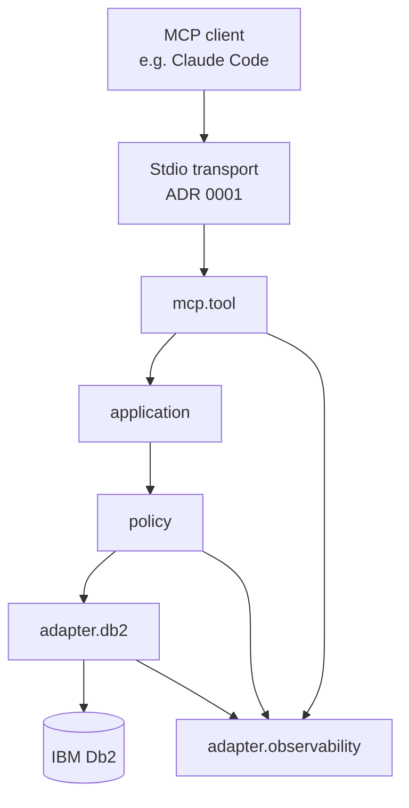

# Governed Db2 MCP Server

A Java 21 and Spring-based reference implementation that connects AI
assistants to IBM Db2 through the Model Context Protocol (MCP). It focuses on
controlled database exploration and bounded diagnostic queries, with access
policies enforced by the server.

## Project focus

- **AI integration** — Give MCP-compatible AI assistants typed tools for
  database exploration and diagnostics, with server-side policy checks on
  tool calls.
- **IBM Db2** — Explore schemas, tables, dependencies, stored procedures and
  reference data, and run bounded diagnostic queries. Db2 is the currently
  implemented database adapter.
- **Security and read-only access** — Treat AI-generated SQL as untrusted.
  Enforce read-only query policies through database permissions, connection
  settings and structural SQL validation. Validate query structure and
  allowed schemas to reject prohibited statements and SQL-injection-style
  attempts to bypass those policies.
- **Controlled capabilities** — Select metadata-only, safe-query or
  advanced-query profiles to determine which tools the AI can discover and
  use; apply query and resource limits.
- **Maintainability** — Separate MCP transport, application logic, access
  policies and database adapters. Support changes with automated tests,
  architecture checks and documented design decisions.
- **Extensibility** — Keep database-specific behavior behind adapter
  interfaces so future integrations can reuse the core application and policy
  layers. Additional database support is a development direction, not a
  current compatibility claim.
- **Observability** — Inspect tool activity and policy decisions through
  sanitized audit events, metrics and tracing, with optional Dynatrace
  export.

Read-only access applies to application data. The optional advanced-query
`explainQuery` tool writes plan metadata to Db2 EXPLAIN tables; it does not
execute the submitted query. These controls are defense in depth, not a
guarantee against every injection or a claim of production certification.

## Why this exists

An LLM-driven coding assistant that can query a production Db2 instance
is genuinely useful — and a genuine risk if the only thing standing
between "explore this schema" and "drop this table" is the model's good
behavior. This project is a production-oriented reference implementation
of the alternative: the server, not the model, is the enforcement point.
Every tool call passes through the same policy chain regardless of what
the LLM was asked to do or how it phrased the request.

What began as a focused MCP experiment evolved through adversarial testing
and cross-model review into a governed reference implementation. The
decision record in [`docs/adr/`](docs/adr/) preserves that evolution,
including assumptions that were rejected and controls strengthened after
real defects were found.


## Capabilities

- **Eleven typed MCP tools** for schema exploration, dependency analysis,
  stored-procedure inspection, reference-data lookup, bounded
  diagnostic queries, and versioned capability discovery — see
  `docs/architecture-diagrams.md` §14.1 and the golden contract snapshot
  (`src/test/resources/mcp-contract-snapshot.json`) for the exact,
  enforced shape of each one.
- **Capability profiles** (`metadata-only` default, `safe-query` for
  bounded `executeQuery` access, `advanced-query` for EXPLAIN-plan
  acquisition under separately configured limits) — a tool
  a profile doesn't allow is invisible to the client, not merely rejected
  when called ([ADR 0006](docs/adr/0006-capability-profiles.md)).
- **Defense-in-depth read-only enforcement** across three independent
  layers — database grants, connection-level read-only intent, and
  structural SQL validation — none of which is presented as sufficient
  on its own ([ADR 0002](docs/adr/0002-read-only-enforcement.md)). One
  documented, bounded exception: `explainQuery` never executes the
  caller's SQL, but `EXPLAIN PLAN FOR` itself is a real write — it
  physically inserts plan metadata into DB2's own
  `EXPLAIN_STATEMENT`/`EXPLAIN_OPERATOR` catalog tables, never the
  caller's own schema data ([ADR 0033](docs/adr/0033-explain-plan-acquisition.md)).
- **Structural, not regex-based, SQL policy**: `executeQuery` is parsed
  as an AST, not pattern-matched, and a schema allowlist rejects
  everything not explicitly permitted
  ([ADR 0007](docs/adr/0007-sql-structural-validation.md),
  [ADR 0008](docs/adr/0008-schema-allowlist.md)).
- **Sanitized traceability**: correlation IDs, audit events, Micrometer
  metrics, and OpenTelemetry spans — all built from a closed vocabulary
  of tool names, policy-decision reasons, and SQLSTATE codes, never raw
  SQL or row data — genuinely exported and observable (a local logging
  exporter, not just instrumented), verified against the real packaged
  jar
  ([ADR 0010](docs/adr/0010-traceability.md),
  [ADR 0011](docs/adr/0011-observability-metrics.md),
  [ADR 0012](docs/adr/0012-opentelemetry-spans.md),
  [ADR 0030](docs/adr/0030-local-observability-export-cr010.md)).
- **Optional enterprise APM export**: opt-in Dynatrace ingest — metrics via
  Micrometer's `DynatraceMeterRegistry`, traces via OTLP — disabled by
  default, so nothing is registered unless it is switched on. Live-verified
  against a real Dynatrace tenant, which is how a silent defect was found:
  this server's short-lived process exited before spans were flushed, so
  trace export was dropping almost everything while appearing to work. Fixed
  with an explicit `forceFlush` in the shutdown sequence and re-verified
  live ([ADR 0036](docs/adr/0036-dynatrace-observability-export.md)).

## Security by design

The database is the asset worth protecting, and the LLM is not a trusted
security principal (`docs/security/threat-model.md`'s explicit starting
assumption). Read access is enforced independently at the database,
connection, and application layers; every rejection path is covered by
an adversarial test aimed specifically at defeating it, not just a
happy-path test that happens to pass
(`docs/security/adversarial-test-cases.md`). Two real gaps that testing
found — a multi-statement SQL bypass, an unsanitized error message — are
documented there exactly as found, not smoothed over after the fix.

This is a **defense-in-depth, policy-controlled reference
implementation** with security controls verified by automated
adversarial tests — not a claim of being "secure" or "production-ready"
without qualification, per this project's own stated documentation
standard (`docs/master-brief.md` §16.4).

The build generates a CycloneDX SBOM, and the repository includes a
threat model and an adversarial test catalogue. These artefacts are
intended to support selected software-supply-chain and secure-development
practices described in
[BSI TR-03183-2](https://www.bsi.bund.de/DE/Themen/Unternehmen-und-Organisationen/Standards-und-Zertifizierung/Technische-Richtlinien/TR-nach-Thema-sortiert/tr03183/TR-03183_node.html)
and
[BSI TR-03185](https://www.bsi.bund.de/DE/Themen/Unternehmen-und-Organisationen/Standards-und-Zertifizierung/Technische-Richtlinien/TR-nach-Thema-sortiert/tr03185/tr-03185.html).

**This is an alignment statement — not a certification, a conformity
assessment, or a legal opinion.** Whether the Cyber Resilience Act, NIS2,
the GDPR or any contractual supplier requirement applies depends on the
actor, the distribution model, the use context and the applicable law,
none of which this repository determines.

## Try it

The [ITSM demo](docs/demo/) is a fictional IT-support schema (no real
people, employers, or internal data) covering nine of the eleven tools —
`getCapabilities` (ADR 0028) reports server-level metadata, not schema
data, and `explainQuery` (ADR 0033) has no dedicated scenario here (see
its own live-DB2 verification in `docs/demo/guided-scenarios.md`'s
checklist instead), so neither is part of a schema-specific demo. Six guided
scenarios in [`docs/demo/guided-scenarios.md`](docs/demo/guided-scenarios.md)
walk through exploring an unfamiliar schema, tracing change impact,
inspecting a stored procedure, resolving encoded values, running a bounded
query, and — deliberately — watching an unsafe query get rejected. Each
scenario states plainly whether it's verified in this environment (H2,
no live DB2 required) or needs a real DB2 instance, the same honesty
standard the whole test suite follows ([ADR 0009](docs/adr/0009-testing-without-live-db2.md)).


```bash
./mvnw -q -DskipTests package

DB2_HOST=<host> DB2_PORT=<port> DB2_DATABASE=<database> \
DB2_USER=<user> DB2_PASSWORD=<password> \
DB2MCP_CAPABILITY_PROFILE=SAFE_QUERY DB2MCP_ALLOWEDSCHEMAS=ITSM \
java -Dloader.path=<path-to-your-ibm-jcc-driver.jar> \
     -jar target/db2-mcp-server-*.jar
```

**`-Dloader.path` is required.** The IBM Db2 JDBC driver is not distributed
with this project — you supply it, under IBM's own terms. Without it the
server refuses to start, with
`Cannot load driver class: com.ibm.db2.jcc.DB2Driver`. See
[`docs/operations/external-jdbc-driver.md`](docs/operations/external-jdbc-driver.md)
for MCP-client configuration, z/OS and Db2-for-i activation files, and
[ADR 0048](docs/adr/0048-external-jdbc-driver.md) for why. Running from
source with `./mvnw spring-boot:run` or the test suites needs no such flag.

Run `docs/demo/itsm-schema.sql` then `docs/demo/itsm-test-data.sql`
against a DB2 instance first — see `docs/demo/guided-scenarios.md` for
the full setup.

## Architecture



The full diagram set — component view, allowed/rejected request
sequences, the read-only defense-in-depth chain, traceability, the
AI-development lifecycle, and the public/private repository topology —
is in [`docs/architecture-diagrams.md`](docs/architecture-diagrams.md).

Built on **Java 21** and **Spring Boot**, with the MCP layer provided by
**Spring AI**'s MCP server starter over the stdio transport — so tool
schemas are generated from typed Java signatures rather than hand-written
JSON, and the governance chain sits behind that boundary rather than
inside the prompt ([ADR 0001](docs/adr/0001-stdio-transport.md)).

> The reference implementation targets IBM Db2 while separating
> MCP/application contracts from database-specific catalog and execution
> adapters. A versioned capability manifest and adapter contract tests
> allow future database implementations without rewriting the governed
> MCP boundary.

That's the adopted database-portability extension's own pre-authorized
portfolio statement
(`docs/master-brief-extension-database-portability.md` §14) — not
included here until it was actually earned: outbound ports return only
domain-owned types ([ADR 0027](docs/adr/0027-phase-p3-dependency-inversion.md)),
a versioned `getCapabilities` manifest exists
([ADR 0028](docs/adr/0028-phase-p4-capability-discovery-and-adapter-selection.md)),
and a test-only fake adapter, wired into the real MCP tool classes,
proves the claim rather than just diagramming it
([ADR 0029](docs/adr/0029-phase-p5-portability-evidence.md)). Db2 is
still the only implemented, tested database — "Supports Db2, Oracle, and
PostgreSQL" remains explicitly not a claim this project makes (extension
§14).

## Engineering quality

- **Layered architecture enforced by ArchUnit**, not just convention —
  five rules covering every dependency-direction invariant, each proven
  able to fail before being trusted
  ([ADR 0005](docs/adr/0005-layer-separation.md)).
- **MCP contract protected by a golden snapshot test** — an
  unintentional change to a tool's name, description, or input schema
  fails the build ([ADR 0013](docs/adr/0013-mcp-contract-snapshot-tests.md)).
- **JaCoCo coverage gate on the policy package** — the code that decides
  `ALLOWED` vs. `REJECTED` carries a higher bar than the rest of the
  codebase ([ADR 0014](docs/adr/0014-jacoco-policy-coverage-gate.md)).
- **Validated configuration and a safe effective-config report** — a
  misconfigured resource limit fails startup with a specific
  property/value/reason, and an operator can inspect what the server
  actually resolved without a credential ever appearing in the output
  ([ADR 0015](docs/adr/0015-config-validation-and-effective-config-report.md)).
- **Graceful shutdown on client disconnect** — including a real bug
  (an orphaned process that never exited when its MCP client closed
  stdin) found by testing the claim, not assuming it
  ([ADR 0016](docs/adr/0016-graceful-shutdown.md)).
- **Two P0 findings from an independent external code review, closed and
  verified** — `lookupRefData` bypassed the capability profile entirely
  (row-data access under `METADATA_ONLY`), and metadata tools leaked raw
  driver exceptions with no sanitization. Both confirmed against the
  actual code before being fixed, not accepted on the reviewer's word
  ([ADR 0020](docs/adr/0020-lookupRefData-policy-and-metadata-error-sanitization.md)).
- **Two Db2 correctness fixes from the same review** — overloaded stored
  procedures are now identified by `SPECIFICNAME`, not just name, and
  foreign-key resolution now follows `SYSCAT.REFERENCES.REFKEYNAME`
  instead of assuming the referenced key is always a primary key. Both
  are Tier 2 (ADR 0009): correct per documented Db2 catalog semantics,
  not yet verified against a live instance
  ([ADR 0022](docs/adr/0022-procedure-overload-identity-and-foreign-key-resolution.md)).
- **Response payload and cell-size limits, independent of the row cap**
  — a single oversized CLOB/BLOB cell could previously defeat `maxRows`
  entirely. Values are also normalized through a closed, safe set of
  representations rather than trusting an unrecognized driver type's raw
  `toString()`. Fully Tier 1: verified against real H2 `Clob`/`Blob`
  values, not mocks
  ([ADR 0023](docs/adr/0023-response-payload-and-cell-size-limits.md)).
- **CI's own claims about itself are now true** — the packaged-jar smoke
  test drives a real MCP JSON-RPC session (`initialize`/`tools.list`/
  `tools.call`), not just a process-health check, and a real (if
  currently self-skipping, no live DB2 in this environment) Failsafe
  integration-test suite exists via a Maven Wrapper-based build
  ([ADR 0024](docs/adr/0024-honest-ci-test-tiers-and-genuine-mcp-smoke-test.md)).
- **Traceability extended well beyond the two row-data tools** — audit
  logging, metrics, and tracing spans extended
  to the seven pure metadata tools, and every structured error now
  carries the same correlation ID its audit line does, so a caller
  reporting a failed call has something to hand back. A second golden
  snapshot now protects every tool's *output* shape, not just inputs
  ([ADR 0025](docs/adr/0025-output-contract-snapshot-all-tool-observability-correlation-id.md)).
  `getCapabilities`, added later ([ADR 0028](docs/adr/0028-phase-p4-capability-discovery-and-adapter-selection.md)),
  and `explainQuery`, added later still
  ([ADR 0033](docs/adr/0033-explain-plan-acquisition.md)), were both built
  with the same treatment from the start rather than needing a separate
  retrofit.
- **The audit trail is bounded, configurable, and fails startup loudly
  rather than disappearing silently** — a rolling, size/time-capped file
  (previously unbounded) at a configurable path, with an independent
  startup check that verifies the destination is writable before the
  server accepts a single tool call. A real, verified nuance found while
  testing it: Spring Boot's own Logback error handling already aborts
  startup for some of the same failure cases — this project's own check
  is deliberately kept anyway, the same "no single layer claimed
  sufficient alone" reasoning as ADR 0002's read-only enforcement
  ([ADR 0026](docs/adr/0026-bounded-configurable-fail-fast-audit-file-lifecycle.md)).
- **Dependency inversion made real, not just diagrammed** — the nine MCP
  result types moved out of the MCP transport package into a
  database-neutral `domain.model`, the outbound ports (`MetadataPort`/
  `QueryPort`) now return only domain-owned types, and DB2 SQLSTATE
  classification moved behind a `DatabaseErrorClassifier` port instead of
  living inside the vendor-neutral `domain.error` package. Two new
  ArchUnit rules enforce it, both proven able to fail against the real
  pre-refactor code — one caught 9 genuine violations — before being
  trusted, not just written and assumed correct
  ([ADR 0027](docs/adr/0027-phase-p3-dependency-inversion.md)).
- **A tenth tool, `getCapabilities`, reports what the server actually
  supports — not a static description of the code.** A versioned
  manifest (effective capabilities, resource limits, connected database
  identity with a *live-queried* JDBC product version, never a hardcoded
  string) visible under every capability profile, so a client under
  `METADATA_ONLY` can discover `readOnlyQuery: false` directly. Db2
  adapter selection is now explicit and configurable
  (`db2mcp.database.product`), with its single-value closed enum as the
  fail-fast mechanism for an unsupported value — verified live against
  the real packaged jar, not assumed from the annotations. Building this
  also surfaced a real, previously-shipped `NullPointerException` bug in
  the shared audit-event code, found, reproduced, and fixed as part of
  the same change
  ([ADR 0028](docs/adr/0028-phase-p4-capability-discovery-and-adapter-selection.md)).
- **Portability proven, not just architected — with zero production code
  changed to prove it.** A test-only `FakeDatabaseAdapter` (no JDBC, no
  Db2 import, confirmed by inspection) wired directly into the real
  `SchemaTools`/`QueryTools`/`ReferenceDataTools` classes and exercised
  end to end, plus two genuinely reusable parameterized contract tests
  running identical assertions against both the real H2-backed Db2
  adapters and the fake. Deliberately doesn't implement capability
  discovery for the fake — doing so would have meant either
  misrepresenting a non-Db2 test double as `DatabaseProduct.DB2` or
  adding a `FAKE` enum value that could then bind as a real
  (non-)selection in production, undermining ADR 0028's own fail-fast
  guarantee. That every one of Phase P3/P4's outbound ports could be
  swapped without touching a single line of `mcp.tool`, `application`,
  or `domain` code is the actual proof that the dependency inversion
  work was done correctly the first time
  ([ADR 0029](docs/adr/0029-phase-p5-portability-evidence.md)).
- **Three P0 findings from a second, cross-model review, closed and
  verified** — metadata tools accepted any caller-supplied schema with no
  allowlist check at all under the default `METADATA_ONLY` profile;
  configured byte/row limits weren't actually hard (a first-row payload
  exemption, a truncation suffix that could push a cell over its own
  stated cap, CLOB truncation budgeted by character count instead of
  bytes, several tools with no limit at all); and validator failures
  forwarded raw parser/identifier detail into client-visible error
  messages. All three independently reproduced against the actual code
  before being fixed, not accepted on the review's word
  ([ADR 0039](docs/adr/0039-close-p0-findings-2026-09-01-review.md),
  [review](docs/reviews/2026-09-01-master-brief-gap-review.md) and
  [response](docs/reviews/2026-09-01-master-brief-gap-review-response.md)).
- **A machine-readable SBOM, generated every build** — the CycloneDX Maven
  plugin produces an aggregate bill of materials at the `package` phase, so
  the exact dependency set of any build is reviewable rather than inferred.
- **Security static analysis that cannot be quietly defeated** — Find
  Security Bugs runs at promotion rather than on every push, and its output
  is compared against an approved baseline by finding *identity*, not count.
  A count cannot distinguish a clean run from one where a known, defended
  finding vanished and a new vulnerability took its place
  ([ADR 0046](docs/adr/0046-security-scan-at-promotion.md)).
- **49 ADRs**, each capturing a decision at the point it was made —
  `Proposed` before implementation, `Accepted` once verified, with
  Consequences updated to real findings rather than left as originally
  anticipated. See [`docs/adr/`](docs/adr/) for the full set.

## Honest limitations

Stated here rather than left for a reviewer to discover:

- **stdio is the supported transport for 1.0.0.** An HTTP transport with
  bearer-token authentication also exists, but it is an **experimental
  prototype, disabled by default**, and enabling it is a deliberate
  operator decision that changes the exposure: it opens a listening port
  where stdio opens none. It binds loopback-only, carries no TLS of its
  own, uses a single shared token with no rotation or revocation, and has
  no rate limiting. **Enterprise authentication and production remote
  deployment are not delivered in 1.0.0.** It was reviewed within exactly
  that boundary — two P1 findings fixed, two P2 findings accepted with
  reasons ([ADR 0037](docs/adr/0037-http-transport-and-authentication-prototype.md),
  [review](docs/security/http-transport-security-review-2026-09-21.md)).
- Eight of eleven tools (the seven pure metadata tools, plus
  `explainQuery`) depend on Db2's `SYSCAT` system catalog and are
  therefore unverifiable in any environment without a live DB2 instance
  — including this project's own development environment. `executeQuery`,
  `lookupRefData`, and `getCapabilities` are verified against H2 in
  DB2-compatibility mode; the rest are marked Tier 2 throughout the docs
  ([ADR 0009](docs/adr/0009-testing-without-live-db2.md)).
- A dedicated query-complexity analyzer exists (`SqlComplexityValidator`,
  [ADR 0034](docs/adr/0034-query-complexity-controls.md)), but it can't
  see through a scalar UDF that itself issues an expensive query inside
  DB2 — structurally invisible to a client-side SQL-text parse (see
  `docs/security/adversarial-test-cases.md`'s "Known gaps" section for
  the full, current list of residual gaps like this one).
- Metrics/span leakage-freedom is currently verified by code inspection
  of a closed tag vocabulary, not by a dedicated test that would fail if
  that ever changed.

Full list in [`docs/security/threat-model.md`](docs/security/threat-model.md#residual-risk).

## AI-driven development

This project is built AI-assisted and human-governed, with automated
verification and auditable architectural decisions — not as a marketing
line, but as the literal process every ADR in this repository was
produced by. See
[`docs/ai-development/development-policy.md`](docs/ai-development/development-policy.md)
for the workflow, the AI-specific rules each backed by a real example
from this repository, and one real, complete change lifecycle
(a genuine bug found and fixed, not a curated success story).

This project uses a human-governed, cross-model AI engineering workflow.
ChatGPT supports architecture, master-brief development, and
implementation review; Claude Code implements the approved direction
through code, tests, ADRs, and technical documentation. The human project
owner retains responsibility for requirements, architectural decisions,
acceptance of findings, and final approval. See
[ADR 0038](docs/adr/0038-human-governed-cross-model-ai-engineering.md) and
the "Cross-model architecture, implementation and review" section of
[`docs/ai-development/development-policy.md`](docs/ai-development/development-policy.md)
for the full workflow.

## Documentation map

Start with the diagrams and the ADRs. The brief and the implementation plan
are the full reference documents behind them — thorough rather than short.

**Start here**

| Document | Covers |
|---|---|
| [`docs/architecture-diagrams.md`](docs/architecture-diagrams.md) | The system, and the same request allowed and rejected, as diagrams |
| [`ARCHITEKTUR.md`](ARCHITEKTUR.md) | Kurzfassung auf Deutsch — the architecture mapped to arc42 chapters, for readers with an arc42/iSAQB background |
| [`docs/adr/`](docs/adr/) | Every architectural decision, in the order it was made, with its alternatives and verified consequences |
| [`docs/demo/`](docs/demo/) | The ITSM demo schema and guided scenarios — run it against a real Db2 |

**How it is secured**

| Document | Covers |
|---|---|
| [`docs/security/threat-model.md`](docs/security/threat-model.md) | Assets, threats, mitigations, explicit non-goals, residual risk |
| [`docs/security/adversarial-test-cases.md`](docs/security/adversarial-test-cases.md) | The adversarial catalogue mapped to real tests |
| [`docs/security/code-review-2026-08-14.md`](docs/security/code-review-2026-08-14.md) | Independent external code review — findings, verification, remediation |
| [`docs/security/http-transport-security-review-2026-09-21.md`](docs/security/http-transport-security-review-2026-09-21.md) | Dedicated review of the HTTP transport prototype — findings, fixes, and what was examined and found sound |

**How it is built**

| Document | Covers |
|---|---|
| [`docs/reviews/`](docs/reviews/) | External code reviews and the disposition of every finding — fixed, deferred with a reason, or rejected with a reason |
| [`docs/ai-development/development-policy.md`](docs/ai-development/development-policy.md) | AI-development governance and a real example lifecycle |
| [`CHANGELOG.md`](CHANGELOG.md) | Notable changes per release |

**Running it, and licensing**

| Document | Covers |
|---|---|
| [`docs/operations/external-jdbc-driver.md`](docs/operations/external-jdbc-driver.md) | Supplying the IBM JDBC driver — `loader.path`, MCP-client configuration, z/OS and Db2-for-i activation files, how to verify it worked |
| [`LICENSE`](LICENSE) | PolyForm Strict 1.0.0, verbatim — the licence for original project material |
| [`ENTERPRISE-EVALUATION.md`](ENTERPRISE-EVALUATION.md) | Supplementary permission for commercial evaluation (version 1.1) |
| [`LICENSE-HISTORY.md`](LICENSE-HISTORY.md) | Which licence governed which release, and why `1.0.0`'s Apache rights still stand |
| [`NOTICE`](NOTICE) | Licensor identification and the full licence stack |
| [`THIRD-PARTY-NOTICES.md`](THIRD-PARTY-NOTICES.md) | Every distributed third-party component, what its licence requires, and where that material came from |
| [`SOURCE-AVAILABILITY.md`](SOURCE-AVAILABILITY.md) | The EPL-2.0 section 3.1(a) source-availability statement for the Logback and Jakarta Annotations components |
| [`third-party-licenses/`](third-party-licenses/) | The licence texts themselves, with a provenance and checksum manifest |
| [`LICENSE-ELECTIONS.md`](LICENSE-ELECTIONS.md) | The dual-licensed dependencies and which option this project elects for this release |

**Full reference**

| Document | Covers |
|---|---|
| [`docs/master-brief.md`](docs/master-brief.md) | The complete governance brief this project implements — the requirements every ADR cites |
| [`docs/implementation-plan.md`](docs/implementation-plan.md) | Phase-by-phase status, what's done and how each item was verified |
| [`docs/master-brief-extension-database-portability.md`](docs/master-brief-extension-database-portability.md) | Adopted extension: adapter-ready architecture for future non-Db2 databases (ADR 0021) |

## Contact
Interested in enterprise Java, governed AI integration, or professional collaboration?

I am open to collaboration with developers, technical co-founders and
partners interested in turning this project into a product or startup.

To be clear about what this is today: a personal, self-initiated reference
implementation, not an established company or a product on sale. Commercial
use and broader rights are available by agreement — see
[Licence](#licence) — and the conversation is welcome either way.

- GitHub: [@marekpompura](https://github.com/marekpompura)
- Email: [marek.pompura.it@gmail.com](mailto:marek.pompura.it@gmail.com)

## Repository model

This is the public edition. Development happens in a private laboratory
repository; mature capabilities are promoted here after review and
curation, which is why this repository's history begins at its first
public release. See [`docs/master-brief.md`](docs/master-brief.md)
section 15.1.

## Status

Current release `1.0.1` — a licensing and packaging release on top of the
first public release (`1.0.0`), with no functional change: the licence for
original material, the removal of the bundled IBM driver, and the
accompanying notices. See [`CHANGELOG.md`](CHANGELOG.md).

The capability set described above is implemented and tested; see
[`docs/implementation-plan.md`](docs/implementation-plan.md) for what is
built and how each item was verified, and **Honest limitations** above for
what this deliberately does not do.

## Licence

Original project material is licensed under the
**[PolyForm Strict License 1.0.0](LICENSE)**, reproduced verbatim with no
clause added, removed or altered. Alongside it, this release carries a
supplementary **[Enterprise Evaluation Permission](ENTERPRISE-EVALUATION.md)**
that adds rights for evaluation by commercial organizations under the
non-production conditions stated in that document.

**Use must fall within the permissions below or a separate agreement.**
The original-code licence does not grant general modification or
redistribution rights. Third-party and previously granted rights remain
unaffected.

| If you are… | What you may do | Under |
|---|---|---|
| An individual, for study, research, experiment, hobby or private use — **without any anticipated commercial application** | Use it freely, with no time limit and no permission needed | PolyForm Strict, *Personal Uses* |
| A charity, school, university, public research body, public safety or health organization, environmental organization or government institution | Use it freely for your work — **including in production** — regardless of how you are funded | PolyForm Strict, *Noncommercial Organizations* |
| A commercial organization evaluating it | Obtain, inspect, compile and run the unmodified software to assess it, with no time limit, in a non-production environment | Enterprise Evaluation Permission |
| A commercial organization wanting to deploy it, build on it, or ship it | [Get in touch](#contact) — commercial use and collaboration are by agreement | A separate agreement |

Three things this licence deliberately does **not** say, because they are
easy to assume:

- **It is not "everyone pays".** Noncommercial use, by individuals and by
  the organizations listed above, is permitted outright and costs nothing.
- **It does not forbid all production use.** PolyForm Strict permits *any
  noncommercial purpose*, production included. The non-production boundary
  applies to the separate commercial-evaluation permission, not to
  noncommercial use.
- **Nothing here disables GitHub's fork button or changes GitHub's terms.**
  The licence governs what rights you hold in the code, not what the
  platform's UI does. Forking to read or to keep a reference copy is a normal
  part of using GitHub. What Strict does **not** grant is the right to modify
  the implementation or to distribute modified versions — so if you want to
  contribute a change, [get in touch](#contact) first and we will agree terms
  for it; please do not assume a fork carries a right to patch and
  redistribute. Fair-use rights are untouched — the licence says so itself.

**Release `1.0.0` was published under the Apache License 2.0, and those
rights stand.** A licence change applies to later releases; it does not
reach back. If you hold `1.0.0`, you hold Apache-2.0 rights in it,
including modification and redistribution. See
[`LICENSE-HISTORY.md`](LICENSE-HISTORY.md); the Apache text is preserved at
[`LICENSES/Apache-2.0.txt`](LICENSES/Apache-2.0.txt).

**Third-party components keep their own licences**, unaffected by any of
this. [`THIRD-PARTY-NOTICES.md`](THIRD-PARTY-NOTICES.md) lists every
distributed component, what its elected licence requires, and where that
material came from; the licence texts are in
[`third-party-licenses/`](third-party-licenses/) and
[`SOURCE-AVAILABILITY.md`](SOURCE-AVAILABILITY.md) carries the EPL-2.0
section 3.1(a) source statement. All of it also ships inside the application
jar under `META-INF/legal/`, so a bare jar download carries its own
compliance material. The build additionally emits a CycloneDX SBOM.

**The IBM Db2 JDBC driver is not distributed with this project.** You supply
it and use it under IBM's terms —
[`docs/operations/external-jdbc-driver.md`](docs/operations/external-jdbc-driver.md)
explains how, and [ADR 0048](docs/adr/0048-external-jdbc-driver.md) explains
why.

Licensor identification and the full licence stack are in
[`NOTICE`](NOTICE).
