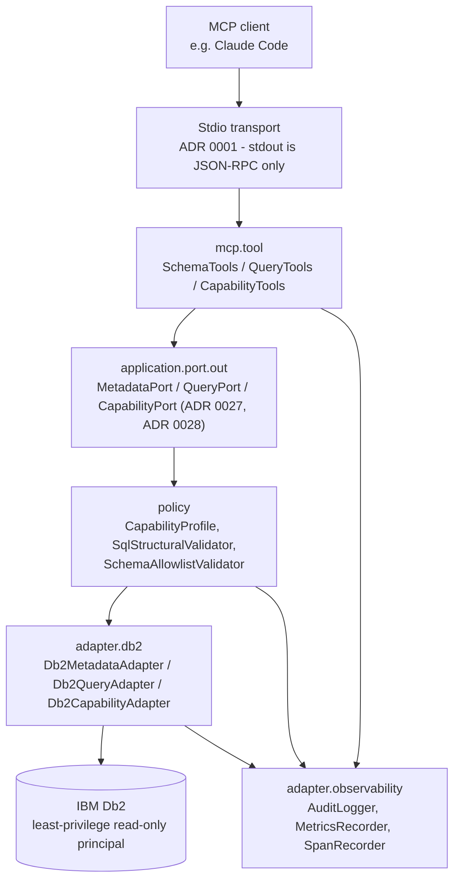
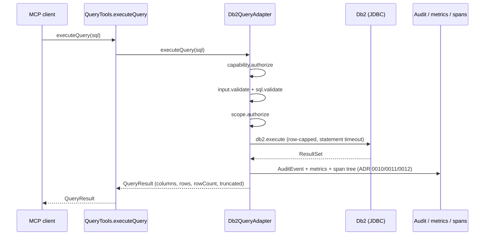
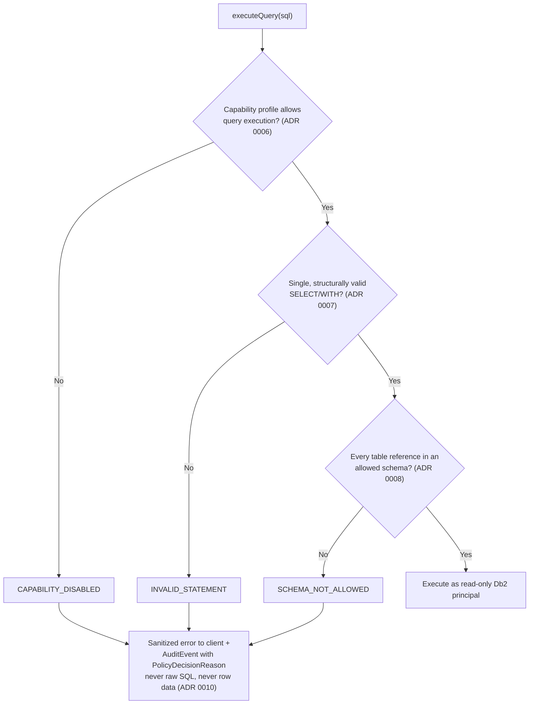
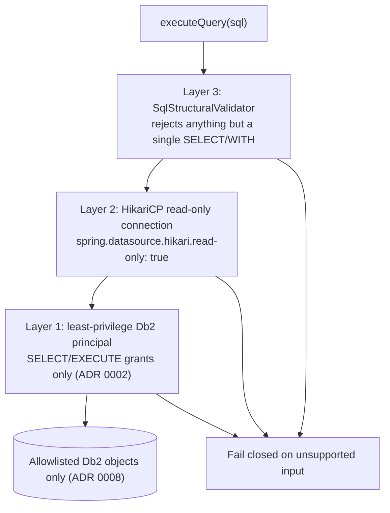
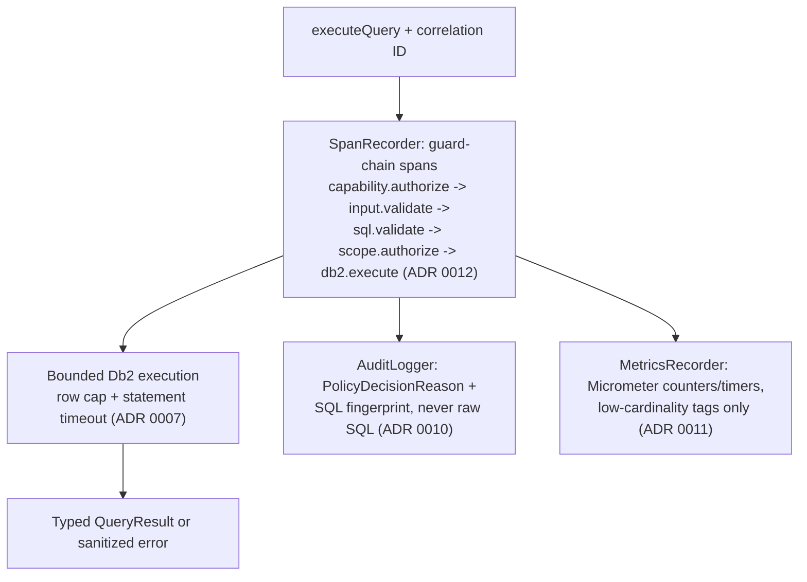
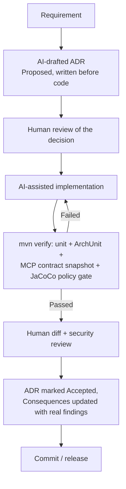
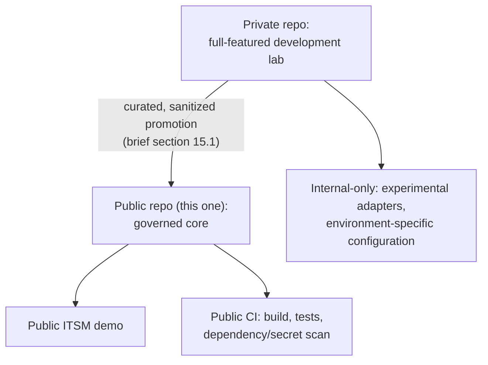

# Architecture and flow diagrams

Master brief section 14's required diagram set, drawn against this
codebase's actual package names, class names, and span names (verified
directly in `Db2QueryAdapter.java`, not reconstructed from memory) rather
than the brief's generic sketch. GitHub renders Mermaid natively; no
export step is required to view these, though PNG/SVG export remains an
option if a non-GitHub presentation context needs it later.

## 14.1 System/component view

Trust boundary: everything left of `adapter.db2` runs in-process with no
network listener of its own (ADR 0001, ADR 0011, ADR 0012 all
independently re-verified this via `lsof` against the packaged jar). The
Db2 credential and the read-only principal it authenticates as are the
only things crossing a real trust boundary, and ADR 0002 enforces
read-only at three independent points along that boundary, not just one.

Everything to the left of the `application.port.out` boundary (`mcp.tool`
and `application`) is provably substitutable, not just diagrammed that
way: `FakeDatabaseAdapter` (test-only, `src/test/.../testsupport/fake`,
zero JDBC/Db2 imports) implements `MetadataPort`/`QueryPort` and is wired
directly into the real `SchemaTools`/`QueryTools`/`ReferenceDataTools`
classes shown above, with all nine backed tool methods exercised end to
end (`FakeAdapterMcpToolsTest`, ADR 0029). It's deliberately absent from
the diagram itself - it's evidence for the boundary's correctness, not a
second production component.

## 14.2 Allowed query request

Span names (`capability.authorize`, `input.validate`, `sql.validate`,
`scope.authorize`, `db2.execute`) are copied verbatim from
`Db2QueryAdapter.executeQuery`, not paraphrased - what a real trace
viewer shows is exactly this.

## 14.3 Rejected malicious request

The three rejection reasons shown are the real `PolicyDecisionReason` enum
values (`domain/audit/PolicyDecisionReason.java`) that appear in audit
log lines and in `docs/security/adversarial-test-cases.md`'s test names -
not illustrative labels invented for this diagram.

## 14.4 Read-only defense in depth

Three independent layers, deliberately redundant with each other (ADR
0002): a bug or bypass in any single layer still leaves the other two
standing, rather than one check with a single point of failure.

## 14.5 Traceability and observability

Both `AuditLogger` (a file, ADR 0026) and `SpanRecorder`/`MetricsRecorder`
(in-process instrumentation) are genuinely exported and observable, not
just instrumented: a local logging `MeterRegistry` and `SpanExporter`
write every meter and span to stderr, verified against the real
packaged jar (ADR 0030).

## 14.6 AI-driven development lifecycle

This is this project's own actual practice, not an aspirational
illustration - every Accepted ADR in `docs/adr/` follows exactly this
loop, including the "Consequences updated with real findings" step (e.g.
ADR 0007's `parseStatements` discovery, ADR 0014's `BUNDLE`-vs-`PACKAGE`
finding, ADR 0016's stdin-EOF bug).

## 14.7 Public/private repository topology

Public history is produced by promoting curated, sanitized content
forward - not by deleting private material after the fact. This public
edition begins with a single curated snapshot commit; brief section 15.1's
promotion workflow governs everything after it. See
`docs/master-brief.md` section 15.1 for the full workflow this diagram
summarizes.
