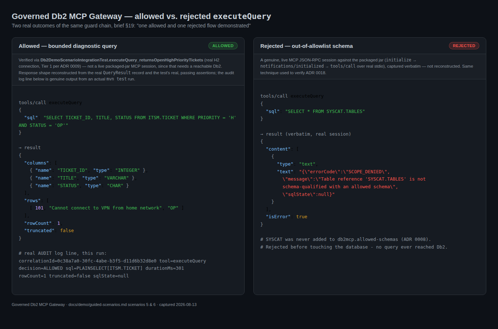

# ITSM demo: guided scenarios

Master brief section 17.1's six guided scenarios, mapped to this server's
actual tools and the [ITSM demo schema](itsm-schema.sql). Every scenario
below states plainly whether it's verified in this development environment
or requires a live DB2 instance - the same Tier 1 / Tier 2 split ADR 0009
established for the test suite applies here too, for the same reason: no
DB2 instance is reachable from this environment (no Docker daemon, no
raw-TCP network access).

Brief §19 asks for "one allowed and one rejected flow demonstrated":



The rejected panel is a genuine, live MCP JSON-RPC session captured
verbatim against the packaged jar (`initialize` → `tools/call` over real
stdio) — the same technique used to verify ADR 0018. The allowed panel's
response shape is reconstructed from the real `QueryResult` record and
`Db2DemoScenarioIntegrationTest`'s actual passing assertions (Tier 1, H2)
rather than a live packaged-jar session, since that scenario needs a
reachable Db2 this environment doesn't have; its audit log line is
genuine output from an actual `mvn test` run, not fabricated. Each
panel states its own provenance rather than presenting both as equally
"live."

## Setup

Assumes a DB2 instance is already reachable, with a `db2` CLP directly on
the machine running these commands. Running DB2 locally via Docker
instead (no `db2` CLP on the host, the CLP lives inside the container)?
See [`live-db2-test-prerequisites.md`](live-db2-test-prerequisites.md)
first.

```
db2 connect to <database>
db2 -td@ -f itsm-schema.sql
db2 -td@ -f itsm-test-data.sql
```

Two files, in that order: `itsm-schema.sql` is structure only (tables,
constraints, procedures, the `ITSM_MCP_READONLY` role and grants);
`itsm-test-data.sql` is the fictional seed data, kept separate so the two
concerns don't mix. `-td@` tells the DB2 CLP to use `@` (not the default
`;`) as the statement terminator, required because `STP_FIND_TICKETS`'s
body contains `;` internally - only `itsm-schema.sql` actually needs it,
but it's harmless on the data-only file too. Point the server at the
resulting database and a principal holding the `ITSM_MCP_READONLY` role
the schema script creates:

```
DB2_HOST=<host> DB2_PORT=<port> DB2_DATABASE=<database> \
DB2_USER=<user> DB2_PASSWORD=<password> \
DB2MCP_CAPABILITY_PROFILE=SAFE_QUERY DB2MCP_ALLOWEDSCHEMAS=ITSM \
java -jar target/db2-mcp-server-*.jar
```

`SAFE_QUERY` is required for scenario 5 (`executeQuery`); the default
`METADATA_ONLY` profile is enough for scenarios 1-4.

---

## Live-DB2 verification checklist

Everything below is Tier 2 today (ADR 0009) - written and reasoned about
against documented DB2 catalog semantics, never run against a real
instance. This is the concrete first thing to do once DB2 is reachable;
each item names the exact tool call, the exact expected result, and which
review finding it closes. Nothing here should require touching code - if
any step's actual result differs from what's written, that's a real bug
to fix, not a doc to quietly reword.

- [x] **CR-003 (ADR 0022) - overloaded procedure identity.**
  `STP_FIND_TICKETS` is deliberately defined twice in `itsm-schema.sql`
  with different parameter lists (`SPECIFIC STP_FIND_TICKETS_BY_STATUS`,
  `SPECIFIC STP_FIND_TICKETS_BY_CUSTOMER`).
  1. `listProcedures(schema: "ITSM")` → **two** entries named
     `STP_FIND_TICKETS`, distinguished only by `specificName`.
  2. `describeProcedure(schema: "ITSM", specificName:
     "STP_FIND_TICKETS_BY_STATUS")` → exactly two `IN` parameters
     (`P_STATUS CHAR(2)`, `P_PRIORITY CHAR(1)`).
  3. `describeProcedure(schema: "ITSM", specificName:
     "STP_FIND_TICKETS_BY_CUSTOMER")` → exactly one `IN` parameter
     (`P_CUSTOMER_ID INTEGER`) - a *different* result from step 2, proving
     `specificName` actually disambiguates rather than both calls
     coincidentally returning the same thing.
  4. `getProcedureSource` for each `specificName` → each returns only its
     own `CREATE PROCEDURE` body, not the other's.
- [x] **CR-004 (ADR 0022) - foreign key referencing a unique constraint.**
  `SERVICE_CATALOG_NOTE.SERVICE_NAME` references
  `SERVICE_CATALOG.UQ_SERVICE_CATALOG_NAME`, not the primary key
  `SERVICE_ID`.
  `getTableDependencies(schema: "ITSM", table: "SERVICE_CATALOG")` →
  **inbound**: `SERVICE_CATALOG_NOTE` via `FK_NOTE_SERVICE_NAME`,
  referencing `SERVICE_NAME` (not `SERVICE_ID`). If this instead comes
  back empty, or reports the wrong referenced column, `REFKEYNAME`
  resolution has a real bug this schema was built specifically to catch.
- [x] **Scenarios 1-3** (below) - re-run as written; every one is Tier 2
  today for the same reason (`SYSCAT` isn't available in H2). Confirm each
  documented result matches exactly, including the row/column counts.
- [x] **`getCapabilities`** (ADR 0028) → `database.productVersion` is a
  real, live DB2 version string, not the graceful-degradation fallback
  `"(unavailable - could not connect)"` - the first proof this server is
  actually talking to DB2 and not silently degrading. Verified against a
  real DB2 12.1.5.0 instance: `productVersion` came back `"SQL120150"` -
  IBM's JDBC driver's `getDatabaseProductVersion()` (which
  `Db2CapabilityAdapter` deliberately calls live rather than hardcoding,
  see that class's own header comment) returns this internal
  `SQLvvrrmm`-style string, not the `DB2/LINUXX8664 x.y.z.w` CLP-banner
  format this item originally, and incorrectly, gave as the example
  (that nicer string comes from the CLP's own connect banner, a different
  code path DB2CapabilityAdapter never calls). Corrected here now that
  the real format is known - the substantive check (a real driver value,
  not the fallback) is what actually proves live connectivity, not the
  specific format.
- [x] **Metrics/span export** (CR-010, ADR 0030) - after running a few
  tool calls, check stderr for `LoggingSpanExporter`/`LoggingMeterRegistry`
  lines, the same assertions `scripts/smoke-test.sh` already makes against
  the H2-backed smoke test - confirming the export path also works with a
  real DB2 connection behind it, not just H2.
- [x] Once every box above is checked, ADR 0022 moves from Tier 2 to
  Tier 1 and Gate B's "live-Db2 catalog behavior verified and documented"
  criterion (`docs/security/code-review-2026-08-14.md` §8) is met - update
  that ADR's status and this checklist itself to record it, not just move
  on silently.
- [x] **CR-003/CR-004/`getCapabilities` above, automated (issue #44,
  2026-09-01 master-brief gap review P1-7, ADR 0044) - 2026-09-09.** This
  checklist's manual, one-time verification is preserved above exactly as
  originally recorded; `Db2LiveCatalogIT`
  (`src/test/java/.../adapter/db2/Db2LiveCatalogIT.java`) now asserts the
  same three claims as a genuine, repeatable automated test, runnable
  locally against any reachable DB2 instance or via
  `.github/workflows/live-db2-it.yml`'s `workflow_dispatch` trigger (a
  throwaway DB2 container, provisioned with these exact
  `itsm-schema.sql`/`itsm-test-data.sql` fixtures). 5/5 tests passing on
  first run against the real `db2-mcp-local` instance.
- [x] **`explainQuery` (ADR 0033) - verified 2026-08-30 against real DB2
  12.1.5.0 CE, all four items now pass.** Item 4 originally failed with a
  confirmed real bug (not a documentation gap); fixed the same day
  (`QUERYTAG`-based correlation replacing `MAX(EXPLAIN_TIME)`) and
  re-verified. ADR 0033 promoted to Accepted. Results:
  1. `getCapabilities` under `ADVANCED_QUERY` → `capabilities.explainPlan`
     is `true`; confirmed `false` under `SAFE_QUERY` too. **PASS.**
  2. `explainQuery(sql: "SELECT * FROM ITSM.TICKET")` → succeeded, returned
     a non-empty `operators` list, `truncated: false`. `EXPLAIN.DDL` is
     pre-provisioned as-is in this image's `sqllib/misc/EXPLAIN.DDL`, and
     tables land in the connecting user's own schema when run without an
     explicit `SET SCHEMA`. **PASS**, with a caveat: this environment only
     ever connects as `db2inst1` (instance owner), never as a genuinely
     restricted role-based user, so the "does `ITSM_MCP_READONLY` need an
     extra grant" question is still open in practice - it does, confirmed
     by inspecting `SYSCAT.ROLEAUTH`, but that grant has never been
     exercised end-to-end since no restricted user exists in this local
     setup. See ADR 0033's Verification section for detail.
  3. `explainQuery` under `SAFE_QUERY` (10 tools) and `METADATA_ONLY` (8
     tools) → absent from `tools/list` in both, confirmed via real
     startup. **PASS.**
  4. Two `explainQuery` calls with different, distinguishably-planned
     statements, sent concurrently → **originally FAIL, now PASS**: in 2 of
     5 runs, one response's `operators` belonged to the *other* request's
     statement, mislabeled under the first request's own (correct)
     `statementText`. Root cause was exactly what ADR 0033 predicted:
     `MAX(EXPLAIN_TIME)` correlation is global, not per-call-scoped. Filed
     as issue #28
     and fixed by switching to a `QUERYTAG`-based join - re-verified
     across 11/11 runs (8 concurrent, 3 spaced) with zero cross-contamination.
     A second, unrelated defect was found incidentally while reproducing
     this (concurrent calls to the *same* tool name - any tool, not just
     `explainQuery` - drop one response with a `"Failed to enqueue
     message"` error, 100% reproducible, unrelated to ADR 0031's
     stdin-EOF race, **still open**): filed as
     issue #29.
  See ADR 0033's Verification section for the full writeup, including the
  false-alarm reproduction attempt (a join query that DB2 legitimately
  optimized away via FK-based join elimination, initially mistaken for
  contamination) ruled out by checking ground truth via CLP directly.
- [x] **Dynatrace observability export (ADR 0036, thread 5) - verified
  2026-09-01 against a real personal Dynatrace trial tenant; all 4 items now
  PASS after fixing a real bug found along the way.** Item 2 initially
  failed - root-caused, filed as
  issue #33,
  fixed, and re-verified live; issue closed, ADR 0036 promoted to Accepted.
  Results:
  1. `db2mcp.dynatrace.enabled: true` with a real environment URL/token →
     server started cleanly, no `DynatraceConfigurationException`. **PASS.**
  2. A real tool call (`getCapabilities`) → its span was created and
     handed to the Dynatrace exporter with no error logged, but **the
     resulting span never appeared in Dynatrace's Distributed Tracing
     Explorer, across ~4 separate runs** - confirmed a genuine
     shutdown-timing race, not an endpoint/auth/format problem (ruled that
     out by hand-building a correct OTLP protobuf payload and POSTing it
     directly via `curl` to the same endpoint/token: `HTTP 200`, appeared
     correctly within seconds). **Initially FAIL**, root-caused and filed as
     issue #33. Fixed with an explicit `sdkTracerProvider.forceFlush().join(...)`
     in `StdioLifecycleConfig`'s shutdown sequence; re-ran the same live
     scenario against the fixed jar and the `mcp.tool getCapabilities` span
     landed in the Distributed Tracing Explorer with no manual workaround.
     **PASS on re-verification.**
  3. The same tool call's metrics (`mcp.tool.calls`) → confirmed landing
     via a Grail DQL query against the real tenant
     (`timeseries value = sum(mcp.tool.calls), from: -13h, interval: 13h`
     returned a real non-null cumulative value), including from runs that
     exited after only ~5 seconds - the metrics path survives a fast
     shutdown even though traces originally didn't. **PASS.**
  4. Grepped the full stderr log from every run for the real API token
     string → zero matches across all runs. **PASS.**
  See ADR 0036's "Live-Dynatrace verification" section for the full
  root-cause writeup and the fix.

- [ ] **HTTP transport and authentication prototype (ADR 0037, thread 6) -
  not yet checked against a real third-party MCP HTTP client.** Unlike the
  two items above, this is not a missing-live-external-system gap:
  everything in this thread is fully locally verifiable and already passes
  (`HttpTransportPropertiesValidatorTest`, `BearerTokenAuthenticationFilterTest`,
  `HttpTransportIntegrationTest` - including a real embedded Tomcat and a
  real MCP SDK client completing a genuine handshake and tool call over
  HTTP with the bearer token). What remains open is real interop: whether
  an actual MCP client someone would really point at this server (Claude
  Desktop, Claude Code, or another language's client library) behaves the
  same way this ADR's own SDK-client-based test does. In particular, the
  MCP spec's own authorization guidance describes an OAuth-discovery-first
  flow (probing `.well-known` metadata before attempting a bearer token) -
  this prototype's plain-401, no-discovery-metadata rejection hasn't been
  checked against a client that expects that flow. Confirm, with
  `db2mcp.http.enabled: true`, a real bearer token, and the packaged jar
  running with `spring.main.web-application-type: servlet`:
  1. Point a real external MCP client at `http://<host>:<port>/mcp` with
     the correct `Authorization: Bearer <token>` header configured however
     that client exposes it → a working session (tool list populates, a
     tool call succeeds), not just this ADR's own SDK-client test.
  2. The same client with no token configured → a rejection the client
     surfaces sensibly to its user, not a confusing hang or a retry loop
     against the `.well-known` discovery endpoint this server doesn't
     serve.
  3. This ADR *was* `Proposed` and explicitly non-promotable for a
     second reason beyond this checklist item (**superseded 2026-09-21:
     the dedicated review is complete and ADR 0037 is now Accepted within
     an experimental prototype boundary** — see
     `docs/security/http-transport-security-review-2026-09-21.md`): the
     roadmap's own framing
     (`docs/research/phase5-roadmap.md` §6) requires a dedicated security
     review before promotion, given HTTP transport's genuinely different
     risk profile (inbound network exposure) from every other thread in
     this phase - that review is a separate, human process step, not
     something this checklist item alone satisfies.
  If real client behavior differs from what's written, update ADR 0037's
  Verification section and this item in place, the same standard every
  other Tier 2 → Tier 1 promotion in this project has held to.

**Verified 2026-08-17** against a real Db2 Community Edition 12.1.5.0
instance (local Docker container, `docs/demo/live-db2-test-prerequisites.md`).
Every item above passed exactly as documented (`productVersion`'s
illustrative example corrected as noted). Two real bugs were found and
fixed on the way to a clean run, both in this directory's demo assets, not
the application: `itsm-schema.sql`/`itsm-test-data.sql` used `;` as the
statement terminator for ordinary statements while only the
`CREATE PROCEDURE` bodies used `@`, so `db2 -td@ -f ...` (this doc's own
documented invocation) failed immediately with `SQL0104N` - fixed by
making every top-level statement terminator `@`, consistently, matching
the invocation this doc has always specified. `itsm-schema.sql`'s
`GRANT USAGE ON SCHEMA ITSM TO ROLE ITSM_MCP_READONLY` failed with
`SQL0557N` - `USAGE` isn't a valid DB2 LUW privilege on a `SCHEMA` object -
removed, since the role's actual `SELECT`/`EXECUTE` grants don't need any
schema-level privilege to work. See `ADR 0022` and `CHANGELOG.md` for the
full record.

---

## Scenario 1 — Explore an unfamiliar schema

*Tier 2 - requires live DB2 (`listSchemas`/`listTables`/`describeTable` read
`SYSCAT.SCHEMATA`/`SYSCAT.TABLES`/`SYSCAT.COLUMNS`, which H2 doesn't have).*

1. `listSchemas` → includes `ITSM` (system schemas like `SYSCAT`/`SYSIBM`
   excluded).
2. `listTables(schema: "ITSM")` → `REF_DATA`, `SERVICE_CATALOG`, `CUSTOMER`,
   `TICKET`, `TICKET_COMMENT`, `SERVICE_CATALOG_NOTE`.
3. `describeTable(schema: "ITSM", table: "TICKET")` → seven columns
   (`TICKET_ID` through `CREATED_AT`), `TICKET_ID` flagged as the primary
   key, correct types and nullability for each.

## Scenario 2 — Understand change impact

*Tier 2 - `getTableDependencies` reads `SYSCAT.REFERENCES`/`KEYCOLUSE`.*

`getTableDependencies(schema: "ITSM", table: "TICKET")` →

- **Outbound** (what `TICKET` depends on): `CUSTOMER` via
  `FK_TICKET_CUSTOMER`, `SERVICE_CATALOG` via `FK_TICKET_SERVICE`.
- **Inbound** (what depends on `TICKET`): `TICKET_COMMENT` via
  `FK_COMMENT_TICKET`.

Demonstrates why dropping or restructuring `TICKET` isn't safe without
checking `TICKET_COMMENT` first - the actual point of this tool.

A second call, `getTableDependencies(schema: "ITSM", table:
"SERVICE_CATALOG")`, is this project's live-DB2 verification case for
CR-004/ADR 0022 - see the checklist above. Its **inbound** dependency
(`SERVICE_CATALOG_NOTE` via `FK_NOTE_SERVICE_NAME`) references
`SERVICE_CATALOG`'s unique constraint on `SERVICE_NAME`, not its primary
key `SERVICE_ID` - the one case in this schema where the referenced key
genuinely isn't the parent's PK.

## Scenario 3 — Inspect procedural logic

*Tier 2 - reads `SYSCAT.PROCEDURES`/`PROCPARMS`.*

1. `listProcedures(schema: "ITSM")` → **two** entries named
   `STP_FIND_TICKETS`, distinguished by `specificName`
   (`SYSCAT.PROCEDURES.SPECIFICNAME`): `STP_FIND_TICKETS_BY_STATUS` and
   `STP_FIND_TICKETS_BY_CUSTOMER` - `specificName` is the identifier the
   next two calls actually need, since `describeProcedure`/
   `getProcedureSource` key on it, not `procedureName` (DB2 allows
   overloaded procedures sharing a schema and name; this is CR-003/ADR
   0022's live-DB2 verification case - see the checklist above).
2. `describeProcedure(schema: "ITSM", specificName:
   "STP_FIND_TICKETS_BY_STATUS")` → two `IN` parameters, `P_STATUS
   CHAR(2)` and `P_PRIORITY CHAR(1)`. The other overload,
   `describeProcedure(schema: "ITSM", specificName:
   "STP_FIND_TICKETS_BY_CUSTOMER")`, returns a *different* single `IN`
   parameter, `P_CUSTOMER_ID INTEGER` - proof `specificName` genuinely
   disambiguates, not just that both calls happen to succeed.
3. `getProcedureSource(schema: "ITSM", specificName:
   "STP_FIND_TICKETS_BY_STATUS")` → that overload's own `CREATE
   PROCEDURE` body from `itsm-schema.sql`, retrieved from
   `SYSCAT.PROCEDURES.TEXT` (SQL procedures only, per that tool's own
   documented limitation) - not the other overload's body.

## Scenario 4 — Resolve encoded values

*Tier 1 - verified in this environment against H2 in DB2 mode, since
`lookupRefData` queries `REF_DATA` directly, not a DB2 catalog view. See
`Db2DemoScenarioIntegrationTest.lookupRefData_resolvesPriorityCodes`.*

`lookupRefData(schema: "ITSM", table: "REF_DATA", codeColumn: "CODE",
descriptionColumn: "DESCRIPTION", filterColumn: "CATEGORY", filterValue:
"PRIORITY")` → `H`→High, `N`→Normal, `L`→Low. The same call with
`filterValue: "STATUS"` resolves `OP`/`IP`/`CL` instead - one generic tool,
any lookup table, not a hardcoded priority-only mapping.

## Scenario 5 — Run a bounded diagnostic query

*Tier 1 - verified in this environment. See
`Db2DemoScenarioIntegrationTest.executeQuery_returnsOpenHighPriorityTickets`.*

`executeQuery(sql: "SELECT TICKET_ID, TITLE, STATUS FROM ITSM.TICKET WHERE
PRIORITY = 'H' AND STATUS = 'OP'")` under the `SAFE_QUERY` profile →
ticket 101 (the VPN connectivity issue), a typed `QueryResult` with
`rowCount`, `truncated: false`, and the two matching columns per row - no
row-limit truncation here since the result set is small, but the same
field would read `true` on a query returning more than
`db2mcp.query.max-rows` rows (ADR 0007).

## Scenario 6 — Demonstrate rejection

*Tier 1 - verified in this environment. See
`Db2DemoScenarioIntegrationTest.executeQuery_rejectsSchemaOutsideAllowlist`
and `...rejectsMultiStatementSql`.*

Two concrete unsafe attempts, both rejected before touching the database:

1. **Out-of-scope schema**: `executeQuery(sql: "SELECT * FROM
   SYSCAT.TABLES")` → rejected by `SchemaAllowlistValidator` (ADR 0008) -
   `SYSCAT` was never added to `db2mcp.allowed-schemas`. Audit log records
   `decision=SCHEMA_NOT_ALLOWED` with the SQL fingerprint
   (`PLAINSELECT[SYSCAT.TABLES]`), never the raw SQL text (ADR 0010).
2. **Hidden write via statement chaining**: `executeQuery(sql: "SELECT 1;
   DROP TABLE ITSM.TICKET")` → rejected by `SqlStructuralValidator` (ADR
   0007) before either statement reaches DB2 - the exact adversarial case
   documented in `docs/security/adversarial-test-cases.md` and the one
   that originally exposed the prefix-only regex gap ADR 0007 records.

Both produce a stable, sanitized error - no raw SQL, no driver internals -
plus a policy-decision audit event and rejection-path span (ADR
0010/0012), demonstrating the same defense-in-depth chain from the inside
that scenario 5 exercises from the allowed side.
