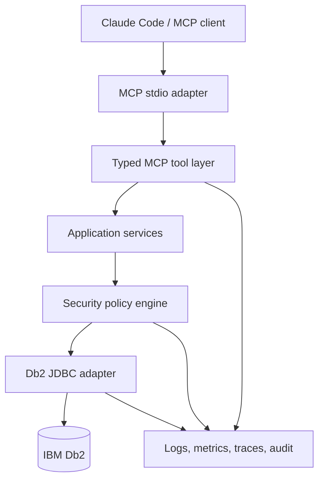
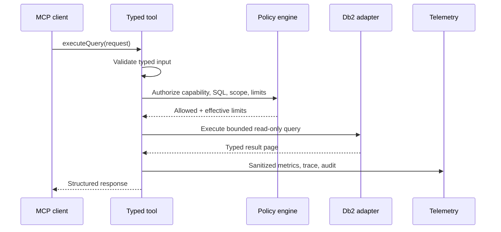
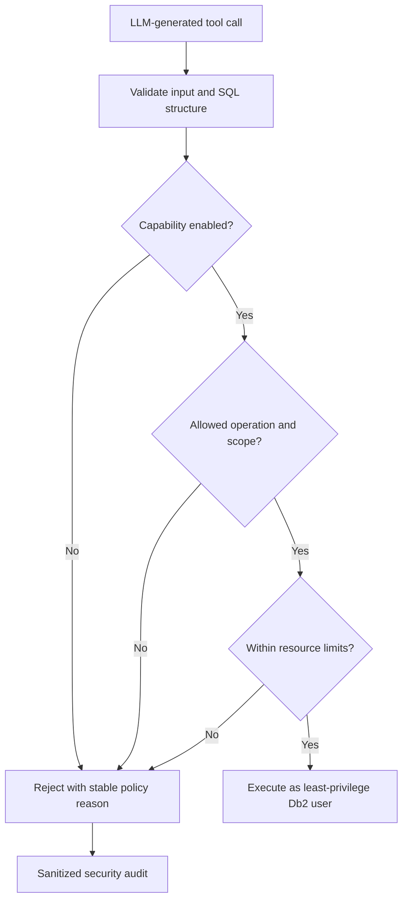
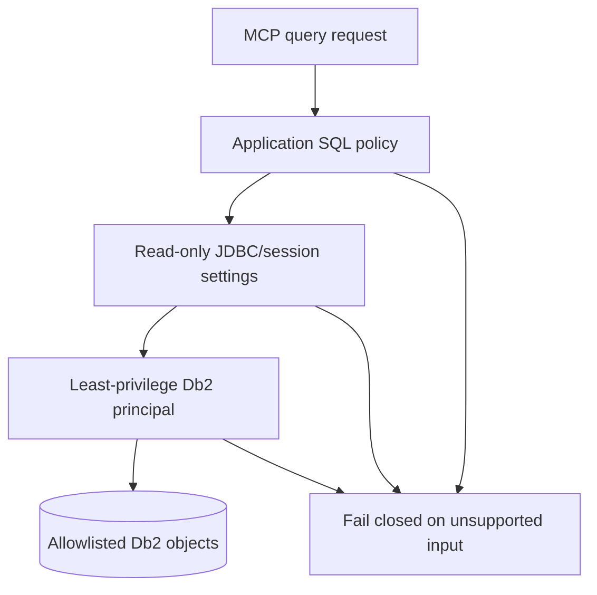
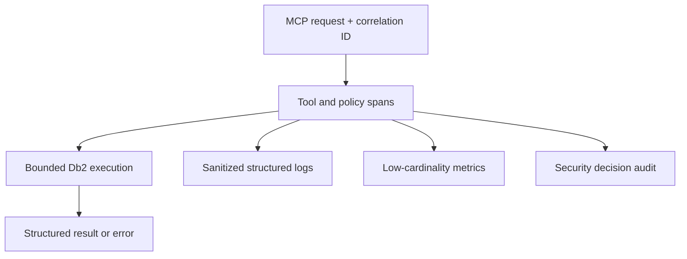
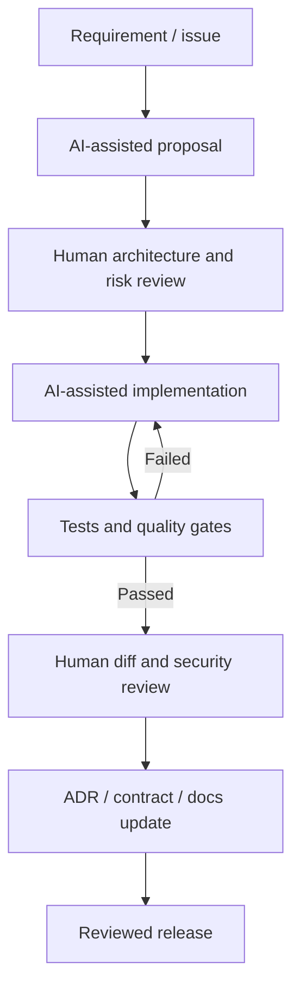
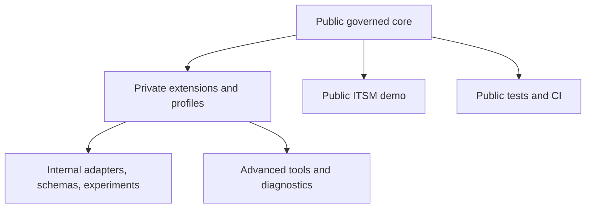

# Governed Db2 MCP Server

## Master implementation brief

> **Public edition note.** Sections 2, 20 and 22 of the internal brief
> covered portfolio positioning and are omitted here. Section numbering is
> preserved so that existing ADR citations remain valid.

**Purpose:** Detailed specification for a Java-based MCP server for IBM Db2, built as an unrestricted private version and a curated public version.

**Primary audience:** the implementation agent, the project owner, and technical reviewers of this codebase.

**Status:** Working architecture and delivery brief. Decisions marked as ADR candidates must be confirmed during implementation.

---

## 1. Executive intent

The project must not be positioned merely as “an MCP server that exposes Db2 metadata.” Its stronger purpose is to demonstrate how modern AI assistants can be integrated with an enterprise database in a way that remains secure, maintainable, observable, traceable, and operationally manageable.

The public project should communicate one central idea:

> **A Java 21 reference implementation for secure, maintainable, observable, traceable, and manageable AI access to enterprise IBM Db2 databases.**

The project should present the author first as a strong enterprise Java engineer who is growing toward Solution Architect / AI Solution Architect roles. MCP and LLM integration are the modern interface; Java engineering, architecture, security, governance, and production readiness are the enduring capabilities.

The private version is an engineering laboratory. It may contain experimental tools, less stable interfaces, richer diagnostics, environment-specific adapters, and proof-of-concept capabilities. The public version is a curated reference product: small enough to understand, safe enough to publish, reproducible, polished, and explicitly designed to communicate architectural judgment.

---

## 3. Product narrative

### 3.1 Problem

AI coding assistants can help developers understand unfamiliar schemas, relationships, stored procedures, reference data, and diagnostic queries. Directly granting an AI agent broad database access is unsafe. Enterprise environments also require auditability, least privilege, operational control, predictable contracts, and protection of sensitive data.

### 3.2 Proposed solution

The gateway exposes a deliberately limited set of typed MCP tools backed by IBM Db2. It mediates all access through validation, capability policies, read-only controls, resource limits, structured errors, and telemetry.

### 3.3 What the project is not

- It is not an autonomous database administrator.
- It is not a general-purpose replacement for DBeaver or another SQL client.
- It does not make LLM-generated SQL inherently safe.
- It does not rely on prompts as a security boundary.
- It does not claim production certification merely because it contains production-oriented patterns.
- **It does not embed, call, or depend on any LLM itself.** The only
  Spring AI dependency is the MCP server starter (protocol/tool-exposure
  plumbing) — no chat-model, embedding-model, or vector-store dependency
  exists anywhere in the codebase. The AI is entirely on the client side,
  external to this repository; this server has no idea what's calling
  it and doesn't need to. That's what makes the governance model (ADR
  0002/0006/0007) meaningful in the first place — every control here
  treats the caller as untrusted precisely because it isn't assumed to
  be any particular AI system, or even an AI system at all.

### 3.4 Suggested name and tagline

**Governed Db2 MCP Server**

*A Java 21 reference implementation for secure, traceable, observable, maintainable, and manageable AI access to enterprise databases.*

---

## 4. Target architecture

### 4.1 Logical layers

```text
MCP transport adapters
        ↓
Typed MCP tool contracts
        ↓
Application use cases
        ↓
Security and query policies
        ↓
Db2 metadata / query ports
        ↓
JDBC adapters
        ↓
IBM Db2
```

Cross-cutting capabilities:

- configuration and capability management;
- validation;
- correlation and security audit;
- logs, metrics, and traces;
- error mapping;
- data classification and redaction;
- contract and architecture verification.

### 4.2 Dependency rule

Dependencies point inward. MCP transport code may invoke application services. Application services may invoke policy services and ports. Db2/JDBC adapters implement ports. The tool layer must never call `JdbcTemplate`, `DataSource`, or JDBC directly.

ArchUnit should verify these rules automatically.

### 4.3 Suggested modules or packages

```text
com.<owner>.db2mcp
├── bootstrap
├── configuration
├── mcp
│   ├── contract
│   ├── tool
│   └── transport
├── application
│   ├── metadata
│   ├── procedure
│   ├── query
│   └── refdata
├── policy
│   ├── capability
│   ├── sql
│   ├── scope
│   ├── limits
│   └── redaction
├── domain
│   ├── model
│   ├── error
│   └── audit
├── adapter
│   ├── db2
│   └── observability
└── operations
```

This may be implemented initially as one Maven module with enforced package boundaries. Multiple modules should be introduced only if they reduce coupling or create a meaningful public/private extension point.

---

## 5. Public MCP capability set

The initial nine tools are sufficient if they are implemented well. Quality, contracts, security, and production behavior matter more than tool count.

1. `listSchemas`
2. `listTables`
3. `describeTable`
4. `getTableDependencies`
5. `listProcedures`
6. `describeProcedure`
7. `getProcedureSource`
8. `lookupRefData`
9. `executeQuery`

### 5.1 Tool design rules

- Every input and output must have a named typed contract.
- Inputs use Bean Validation where applicable.
- Outputs must be deterministic and bounded.
- Errors use one documented structured format.
- Each tool has a clear title, description, and JSON schema.
- Tool annotations should declare read-only and non-destructive intent where supported.
- Annotation hints are metadata, not a security control.
- Sensitive implementation details must not leak through errors.
- Pagination behavior must be explicit and consistent.
- Tool contracts must be snapshot/compatibility tested.

### 5.2 Suggested typed result models

- `SchemaInfo`
- `TableInfo`
- `ColumnInfo`
- `PrimaryKeyInfo`
- `ForeignKeyInfo`
- `TableDependencyInfo`
- `ProcedureInfo`
- `ProcedureParameterInfo`
- `ProcedureSource`
- `ReferenceDataEntry`
- `QueryColumn`
- `QueryResultPage`
- `Db2Error`
- `PolicyRejection`
- `ToolResponseMetadata`

### 5.3 Common response metadata

Where useful, responses may include:

- `correlationId`;
- effective policy profile;
- returned item count;
- truncation or pagination indicator;
- continuation token or offset;
- execution duration category, if exposing exact time is unnecessary;
- warnings such as result truncation or redaction.

Avoid exposing internal hostnames, usernames, filesystem paths, SQL text with secrets, stack traces, or raw connection details.

---

## 6. Capability profiles

Risky capabilities must not be enabled simply because a tool exists.

### 6.1 `metadata-only` profile

Recommended public default.

- Schema, table, column, dependency, procedure metadata, and approved procedure source access.
- No arbitrary SQL execution.
- Allowlist of visible schemas.
- System schemas excluded by default.

### 6.2 `safe-query` profile

- Enables bounded `executeQuery`.
- Only structurally validated read-only queries.
- Schema/table allowlist.
- Query timeout.
- Maximum rows and maximum payload bytes.
- Maximum joins, nesting, or other complexity thresholds if reliably enforceable.
- No multiple statements.
- No procedure calls.
- No data-change table references.

### 6.3 `advanced-query` profile

Private experimentation only by default.

- Broader diagnostic queries.
- May support explain-plan experiments or configurable policy exceptions.
- Must be explicitly enabled.
- Must never weaken database-account least privilege.
- Not included in the initial public release unless its guarantees and tests are convincing.

---

## 7. Defense-in-depth security model

### 7.1 Trust assumptions

- The LLM can be manipulated by prompt injection.
- The MCP client may submit malformed, adversarial, or unexpectedly expensive input.
- SQL text can be obfuscated.
- A prefix check for `SELECT` or `WITH` is insufficient.
- Application controls can contain bugs.
- Observability output can accidentally disclose sensitive information.

### 7.2 Three independent read-only layers

At minimum:

1. **Database authorization:** dedicated Db2 user with only the required catalog and `SELECT` privileges on allowed objects.
2. **Connection/session intent:** JDBC connection marked read-only where supported, with explicit transaction behavior.
3. **Application policy:** structural SQL validation, scope enforcement, blocked constructs, and resource limits.

These layers are complementary. No single layer should be marketed as sufficient by itself.

### 7.3 SQL safety requirements

- Prefer structural parsing/AST validation over regex-only validation.
- Reject multiple statements.
- Reject DDL, DML, DCL, transaction control, calls, anonymous blocks, and commands not explicitly allowed.
- Reject Db2 data-change table references such as `FINAL TABLE`, `OLD TABLE`, and `NEW TABLE`.
- Reject access outside allowed schemas and tables.
- Treat quoted identifiers and comments correctly.
- Define policy for common table expressions, subqueries, unions, functions, and special registers.
- Apply query timeout at JDBC/driver level.
- Apply server-side row and payload-size limits.
- Consider query-cost controls only if they are deterministic enough to explain and test.
- Return a stable policy rejection code and sanitized reason.

### 7.4 Data protection

- Support denied or redacted columns.
- Do not log raw result rows.
- Do not log credentials or connection strings.
- Default to SQL fingerprints or normalized/redacted statements rather than raw SQL.
- Make raw SQL logging an explicit local/private diagnostic option, disabled by default.
- Cap metadata enumeration to prevent bulk extraction.
- Consider classification tags for columns such as email, personal identifiers, financial data, or secrets.

### 7.5 Abuse and availability protection

- Bound connection pool size.
- Bound concurrent tool executions.
- Enforce timeouts and result-size limits.
- Reject pathological cross joins or other known expensive shapes where feasible.
- Provide cancellation where the JDBC driver supports it.
- Record rejections and cancellations in sanitized telemetry.

### 7.6 Adversarial test catalogue

Create `docs/security/adversarial-test-cases.md` and automated tests for:

- write statement submitted directly;
- write statement hidden behind comments or whitespace;
- multiple statements;
- `SELECT` using `FINAL TABLE`, `OLD TABLE`, or `NEW TABLE`;
- access to a non-allowlisted schema;
- quoted or case-manipulated identifiers;
- procedure invocation;
- attempts to enumerate system catalogs outside policy;
- huge result extraction;
- query timeout;
- large cross join or excessive nesting;
- sensitive value leakage through errors;
- sensitive value leakage through logs, metrics, traces, or audit;
- prompt-injection scenario that asks the model to bypass the server policy.

The test should prove that the server remains the enforcement point even when the AI client requests an unsafe action.

---

## 8. Traceability model

Each tool request should generate a correlation identifier and a trace context. The following events should be reconstructable without storing sensitive payloads:

- tool name and contract version;
- request/correlation identifier;
- active capability profile;
- selected database profile identifier, without credentials;
- policy decision: allowed, rejected, or allowed-with-effective-limits;
- stable policy reason code;
- normalized SQL fingerprint when applicable;
- start time and duration;
- row count and payload-size category;
- success, rejection, cancellation, or failure;
- Db2 SQLSTATE/SQLCODE classification for failures;
- redaction or truncation applied.

Separate these concerns:

- **application log:** debugging and lifecycle information;
- **security audit:** who/what attempted which capability and what policy decided;
- **metrics:** aggregate runtime behavior;
- **distributed trace:** timing and causality across request stages.

Traceability should also cover development:

- issue or requirement;
- AI-assisted proposal;
- implementation or pull request;
- tests and automated gates;
- related ADR;
- release version and changelog.

---

## 9. Observability specification

### 9.1 Technology direction

- Micrometer for application metrics.
- OpenTelemetry for traces and vendor-neutral export.
- Structured JSON logging in an operational profile.
- Optional examples for Grafana/Prometheus and Dynatrace.
- Spring Boot Actuator where compatible with the chosen transport and deployment model.

### 9.2 Metrics

Suggested names may be adapted to Micrometer conventions:

- `mcp.tool.calls` by tool and outcome;
- `mcp.tool.duration` by tool;
- `mcp.tool.rejected` by policy reason;
- `mcp.result.rows` by tool, using safe cardinality;
- `mcp.result.bytes` distribution;
- `db2.query.duration` by query category, not raw SQL;
- `db2.errors` by SQLSTATE family or stable category;
- `security.policy.decisions` by profile, decision, and reason;
- HikariCP connection-pool metrics;
- request cancellation and timeout counts.

Do not use unbounded labels such as correlation ID, raw SQL, table name from arbitrary input, user-entered text, or error message.

### 9.3 Traces and spans

Suggested span hierarchy:

```text
mcp.tool <tool-name>
├── input.validate
├── capability.authorize
├── sql.validate              # query tools only
├── scope.authorize
├── db2.execute
├── result.redact
└── response.serialize
```

Span attributes must be allowlisted and sanitized. Do not attach raw rows, parameters, credentials, or unrestricted SQL.

### 9.4 Health and readiness

- Application liveness must not require a live database query.
- Readiness may validate configuration and a bounded database connection check.
- Health output must not expose credentials or internal topology.
- Stdio mode needs an appropriate alternative to HTTP-only operational endpoints, such as logs/metrics export or an optional management port.

### 9.5 Portfolio evidence

The public repository should contain:

- a short observability guide;
- one example dashboard screenshot or JSON dashboard if practical;
- a trace screenshot showing tool → policy → Db2 spans;
- example sanitized log and audit events;
- documented telemetry privacy rules.

---

## 10. Manageability specification

- Externalized configuration via environment variables and/or YAML.
- Startup validation with actionable error messages.
- Profiles such as `demo`, `local`, and `enterprise`.
- Capability profiles: `metadata-only`, `safe-query`, and private `advanced-query`.
- Schema and table allowlists.
- Centralized limits for timeout, rows, bytes, and concurrency.
- Safe effective-configuration report with secrets redacted.
- Graceful shutdown and cancellation.
- Bounded HikariCP pool.
- Connection diagnostic operation limited to safe information.
- Version and build metadata.
- Feature flags only when they do not create untestable combinations.

Configuration precedence and defaults must be documented and tested.

---

## 11. Maintainability and quality gates

### 11.1 Code quality

- Maven Enforcer for Java and dependency constraints.
- Spotless or Checkstyle for deterministic formatting.
- SpotBugs and selected PMD rules where signal is useful.
- JaCoCo with meaningful coverage thresholds, especially for policies.
- ArchUnit for layer and dependency rules.
- OWASP Dependency-Check or an equivalent maintained dependency scanner.
- Secret scanning and repository hygiene checks.
- Automated dependency update workflow with review.

Avoid adding tools solely to increase badge count. Every gate needs a clear purpose, stable configuration, and manageable false-positive rate.

### 11.2 Test pyramid

- Unit tests for policy rules, validation, mapping, and redaction.
- Contract tests for MCP names, descriptions, annotations, input schema, output schema, and errors.
- Architecture tests for package boundaries.
- Integration tests against real Db2 for catalog behavior and SQL semantics.
- Adversarial security tests.
- Smoke test covering server startup and at least one end-to-end MCP flow.
- Performance baseline for representative metadata and bounded query operations.

### 11.3 Contract compatibility

The build should fail when a public tool contract changes unintentionally. Store a reviewed representation of:

- tool names;
- input JSON schemas;
- output JSON schemas;
- tool annotations;
- error codes and shapes;
- pagination semantics.

Intentional breaking changes require explicit snapshot update, changelog entry, and versioning decision.

### 11.4 Error model

Define stable categories such as:

- `VALIDATION_FAILED`;
- `CAPABILITY_DISABLED`;
- `POLICY_REJECTED`;
- `SCOPE_DENIED`;
- `QUERY_TIMEOUT`;
- `RESULT_LIMIT_EXCEEDED`;
- `DB2_AUTHORIZATION_FAILED`;
- `DB2_OBJECT_NOT_FOUND`;
- `DB2_EXECUTION_FAILED`;
- `INTERNAL_ERROR`.

Expose SQLSTATE and SQLCODE only when safe and useful. Never expose stack traces to the MCP client by default.

---

## 12. AI-driven development governance

Create `docs/ai-development/development-policy.md`.

### 12.1 Core principle

> AI-assisted, human-governed software development with automated verification and auditable architectural decisions.

### 12.2 Required workflow

1. Start from an issue or written requirement with acceptance criteria.
2. Let the AI propose design and implementation options.
3. Human reviews assumptions, risk, API impact, and architecture.
4. AI may implement within the approved scope.
5. Automated tests and quality gates verify behavior.
6. Human reviews the diff, security impact, and generated tests.
7. Update ADR, contract snapshot, threat model, and documentation when relevant.
8. Merge through a reviewed pull request.

### 12.3 AI-specific rules

- AI output is not evidence of correctness.
- AI must not invent supported Db2 behavior; ambiguous behavior requires documentation or integration tests.
- AI must not silently weaken a policy to make a test pass.
- Generated tests must include assertions that would fail for an unsafe implementation.
- Security-sensitive changes require explicit human review.
- Dependency additions require purpose, license, maintenance, and vulnerability review.
- Prompts, outputs, or traces containing internal data must not enter the public repository.

### 12.4 Repository evidence

Include one sanitized example change lifecycle:

```text
Requirement → AI proposal → human decision → implementation → tests → ADR/contract update → release note
```

Do not publish an unfiltered archive of prompts. Curate an example that shows engineering control without exposing private data or producing documentation noise.

### 12.5 Cross-model architecture, implementation, and review

This project separates architecture/review support from implementation
across two AI systems, both subordinate to the human project owner's
final approval: ChatGPT supports target-architecture direction,
master-brief development, and security/portfolio strategy, and separately
reviews the resulting repository against this brief; Claude Code
implements the approved direction and validates every review finding
against the actual repository — classifying each as `Confirmed`,
`Rejected with evidence`, `Accepted risk`, or `Deferred` — before any
finding is acted on. This is not an independent human security audit, and
neither AI holds final decision authority. See
`docs/adr/0038-human-governed-cross-model-ai-engineering.md` for the full
decision record and `docs/ai-development/development-policy.md`'s
"Cross-model architecture, implementation and review" section for the
lived workflow; this subsection intentionally does not duplicate either.

---

## 13. Architecture Decision Records

Use a compact ADR template:

```text
Title
Status
Date
Context
Decision drivers
Considered options
Decision
Consequences: positive, negative, risks
Verification / enforcement
Related decisions
```

An ADR must document a genuine decision with alternatives and consequences. Do not create ADRs for obvious implementation trivia.

### 13.1 Recommended initial ADR set

#### ADR-0001 — Use stdio as the initial MCP transport

- Why stdio is appropriate for local coding assistants.
- Security and deployment advantages.
- Operational limitations compared with Streamable HTTP.
- Conditions that would justify adding HTTP later.

#### ADR-0002 — Enforce read-only access through three independent layers

- Least-privilege Db2 account.
- JDBC/session read-only intent.
- Application policy and SQL structural validation.
- Explicit acknowledgement that none is sufficient alone.

#### ADR-0003 — Use a version-pinned Db2 JDBC driver from Maven Central

- Reproducible builds.
- Avoid dependence on local DBeaver caches.
- Version, licensing, upgrade, and vulnerability considerations.

#### ADR-0004 — Separate transport, application, policy, and Db2 adapter layers

- Ports/adapters or clean-layer reasoning.
- Dependency direction.
- ArchUnit enforcement.
- Avoid unnecessary framework abstraction.

#### ADR-0005 — Use typed MCP contracts instead of generic maps

- Java records/DTOs.
- Generated JSON schemas.
- Validation and compatibility tests.
- Stable structured error model.

#### ADR-0006 — Expose capabilities through explicit security profiles

- `metadata-only` default.
- `safe-query` opt-in.
- `advanced-query` private/experimental.
- Safe defaults and migration consequences.

#### ADR-0007 — Validate SQL structurally and enforce resource limits

- Parser/AST strategy and Db2 dialect limitations.
- Blocked constructs and allowlists.
- Timeout, row, byte, and concurrency limits.
- Fail-closed behavior for unsupported syntax.

#### ADR-0008 — Provide end-to-end traceability without retaining sensitive data

- Correlation IDs.
- SQL fingerprints.
- Policy decision events.
- Redaction and retention boundaries.

#### ADR-0009 — Use Micrometer and OpenTelemetry for observability

- Vendor neutrality.
- Logs/metrics/traces separation.
- Cardinality and privacy rules.
- Optional Grafana and Dynatrace exporters.

#### ADR-0010 — Protect MCP contracts with automated compatibility tests

- Snapshot content.
- Intentional breaking-change workflow.
- Versioning consequences.

#### ADR-0011 — Use AI-assisted, human-governed development

- Allowed uses of AI.
- Human responsibilities.
- Verification gates.
- Traceability without publishing sensitive prompt histories.

#### ADR-0012 — Keep the public core separate from private extensions

- Repository topology.
- No copying from a private history into a public branch.
- Extension/configuration strategy.
- Secret and provenance controls.

### 13.2 Possible later ADRs

- Add Streamable HTTP and OAuth 2.1.
- Choose a query parser strategy.
- Introduce multi-database or adapter abstractions.
- Choose explain-plan implementation.
- Define audit retention and external sink integration.
- Define data-classification and column-redaction policy.

Only create these when the decision is actually needed.

### 13.3 Adopted ADRs beyond the initial set

The initial set above (ADR-0001 through ADR-0012) was the plan at project
start. Implementation has since produced a much longer real ADR sequence
(`docs/adr/`, currently through ADR-0032) as genuine decisions came up
during build-out — that directory, not this section, is the authoritative
list. Two recent ones are worth calling out here specifically, since they
revise/extend decisions this brief already made assumptions about:

#### ADR-0031 — Drain in-flight MCP requests before stdin-EOF shutdown

- Closes a real, reproduced bug: the stdio transport's inbound and
  outbound threads coordinate only through a shared `isClosing` flag: a
  tool call still executing the instant stdin reached EOF had its
  response silently dropped, not delayed.
- The fix blocks the EOF-triggering `read()` call itself until every
  already-read request has a written response, rather than delaying
  shutdown after the fact — real MCP clients never trigger this path (they
  don't close stdin mid-call), so it defends only the disconnect-mid-call
  edge case, not ordinary shutdown latency.
- Shipped in two stages: a fixed-delay heuristic first (guessing an upper
  bound on the SDK's reactor scheduler-handoff duration), then replaced
  with an id-based deterministic tracker after the heuristic was observed,
  empirically, to still fail intermittently on a contended CI runner —
  see the ADR for the full before/after story.

#### ADR-0032 — Give ADVANCED_QUERY a real, differentiated policy

- Closes a placeholder gap from ADR-0006: `ADVANCED_QUERY` had been
  byte-for-byte identical to `SAFE_QUERY` everywhere in the codebase,
  since no advanced-only capability existed yet.
- First real distinction: its own, independently configured query-limits
  envelope (more generous `maxRows`/timeout/cell/payload bounds), resolved
  once so the query adapter's enforcement and the capabilities manifest
  can never disagree about what's actually in effect.
- Grants no additional Db2 privileges and relaxes neither the schema
  allowlist nor SQL structural validation - §6.3's "must never weaken
  least privilege" is unchanged. Explain-plan and query cost/complexity
  thresholds are explicitly out of scope here, sequenced as later Phase 5
  roadmap threads (§18, Phase 5).

---

## 14. Required architecture and flow diagrams

Store diagram sources as Mermaid or PlantUML text in the repository. Export SVG/PNG versions for README consumption if GitHub rendering or presentation quality requires them.

### 14.1 System/component view



The final diagram should identify trust boundaries, credentials ownership, the read-only Db2 principal, and cross-cutting telemetry without becoming visually crowded.

### 14.2 Allowed query request



### 14.3 Rejected malicious request



### 14.4 Read-only defense in depth



### 14.5 Traceability and observability



### 14.6 AI-driven development lifecycle



### 14.7 Public/private repository topology



The diagram must make it clear that public code is the reusable core and private additions depend on it. Public history is not produced by deleting private files later.

---

## 15. Public and private diversification strategy

### 15.1 Repository strategy and feature promotion

> **Revision note:** this subsection replaces the brief's original "Governing principle" (build public-safe from day one). The project instead builds the private repository first, as the unrestricted feature-complete laboratory, and promotes mature capabilities to the public repository afterward via a controlled, sanitized cherry-pick workflow. The risk the original wording warned about — internal detail surviving in Git history — is addressed structurally below, not by avoiding the private-first approach.

Both repositories are single-maintainer projects. The private repository is the unrestricted development laboratory and the primary source of new capabilities. It may contain experimental features, internal integrations, environment-specific configurations, incomplete approaches, and capabilities that are unsuitable for public release.

The public repository is an independent, curated edition intended for technical reviewers, engineering managers, potential clients, and the wider developer community. It contains only mature, relevant, documented, tested, and sanitized capabilities that strengthen the project's public architectural narrative.

The public repository must have its own clean Git history. It must not be created by making the private repository public, converting it into a public fork, or publishing its complete history after removing internal files. Deleting sensitive content from the current working tree does not remove it from earlier commits.

Selected mature features are promoted from private to public using:

```
git cherry-pick --no-commit <commit>
```

Using `--no-commit` applies the selected changes to the public working tree without immediately creating a commit. This allows the transferred changes to be reviewed, adapted, sanitized, and tested before they enter the public history. The final public commit should use a clean public-facing commit message and does not need to preserve the private commit message or private development context.

The public repository is bootstrapped differently from the per-feature promotions described above: its first commit is a single curated, sanitized snapshot of the mature tree, which is how a clean history is established without ever copying private history. The cherry-pick workflow governs every promotion after that first commit.

If a private commit mixes reusable functionality with internal details, it must not be cherry-picked unchanged. The relevant changes should instead be selectively transferred, rewritten, or recreated as a focused public commit.

Before committing a promoted feature, the maintainer should verify that the staged changes contain no:

- credentials, tokens, certificates, or secrets;
- internal hostnames, URLs, network details, or database identifiers;
- company, client, project, schema, table, or package names;
- proprietary business logic or internal data structures;
- sensitive fixtures, logs, comments, examples, or generated files;
- private references in documentation or commit metadata;
- author or company email addresses that should not be public.

The promoted version must pass the public repository's tests, quality gates, dependency checks, and secret-scanning workflow before publication.

Feature promotion is primarily one-way:

```
private development repository → reviewed promotion → public portfolio repository
```

Changes made directly in the public repository should be deliberately reproduced or transferred back into the private repository when relevant. Routine bidirectional merging should be avoided because the repositories serve different purposes and do not represent identical products.

This workflow does not require contributor synchronization, shared branching governance, or coordination between development teams. Its purpose is to preserve freedom of experimentation in the private repository while maintaining a coherent, secure, and professionally presented public product without exposing the private repository's Git history.

### 15.2 Public version: purpose

The public repository is a curated edition aimed at technical reviewers and engineering managers. It must be understandable in minutes, runnable without internal infrastructure, and deep enough to reward technical inspection.

### 15.3 Public version: include

#### Product and documentation

- Strong executive README.
- Clear problem statement and use cases.
- Java 21 / Spring Boot / Spring AI technology summary.
- Architecture diagram and core flow diagrams.
- Security model and limitations.
- ADR set with meaningful trade-offs.
- Threat model and adversarial test catalogue.
- AI-development governance.
- Operations and observability guide.
- Changelog, roadmap, contribution guide, code of conduct if appropriate, and license.

#### Code

- The nine curated MCP tools.
- Typed request, response, and error contracts.
- Capability profiles with safe default.
- Policy engine and defense-in-depth controls.
- Db2 JDBC adapter.
- Sanitized logging, metrics, traces, and audit events.
- Architecture, contract, unit, integration, and adversarial tests.
- Externalized configuration with sample values only.

#### Reproducible demo

- Fictional ITSM schema and data.
- Db2 Community Edition container/demo approach if license and platform constraints permit.
- Automated schema initialization.
- One-command or clearly scripted startup.
- Smoke test.
- Example client configuration with placeholder paths and credentials.
- Three to five guided demonstration scenarios.

#### CI and software supply chain

- Compile and test on supported Java version.
- Formatting/static analysis gates.
- Dependency and secret scans.
- Software bill of materials if practical.
- Reproducible tagged releases.
- Version-pinned dependencies and documented upgrade policy.

#### Portfolio evidence

- Short demo GIF or video.
- Architecture overview visible near the top of README.
- Example rejected malicious request.
- Example trace/dashboard with synthetic data.
- Badges only for meaningful signals: build, release, license, coverage/security when reliable.

### 15.4 Public version: exclude

- Real company names, project names, schema names, hostnames, usernames, email addresses, ticket identifiers, or internal terminology.
- Real customer or employee data.
- Production SQL, stored procedure source, execution plans, or catalog extracts.
- Internal architecture diagrams or network topology.
- Credentials, tokens, certificates, connection strings, or secret locations.
- Internal prompts or chat histories.
- Proprietary libraries, copied code, internal base classes, or employer-owned conventions.
- Detailed security findings that would expose a real environment.
- Experimental tools that are difficult to secure or explain.
- Raw SQL logging enabled by default.
- Unbounded query execution.
- Company-specific observability endpoints or dashboards containing identifiers.
- Commit history originating from an internal repository.

### 15.5 Private version: purpose

The private repository is a controlled laboratory and integration layer. It exists to explore possibilities, validate design choices, test against realistic environments, and build internal extensions without weakening the clarity or safety of the public artifact.

### 15.6 Private version: include

- Experimental MCP tools.
- `advanced-query` profile.
- Explain-plan capture and analysis experiments.
- Query cost estimation and policy research.
- Multi-database profiles.
- Internal schema adapters and metadata conventions.
- Organization-specific reference-data discovery.
- Rich diagnostic modes, strictly disabled by default.
- Internal Dynatrace configuration and dashboard experiments.
- Performance testing against realistic volumes.
- Prompt-injection and red-team experiments.
- Candidate HTTP/Streamable HTTP transport and authentication work.
- Prototype policy engine or external policy-management integration.
- Internal deployment manifests.
- Compatibility testing across actual Db2 versions.
- Raw diagnostic artifacts only when authorized and protected.

### 15.7 Private version: still prohibit

Private does not mean uncontrolled. Do not commit:

- secrets or production credentials;
- personal data unless explicitly authorized and protected;
- unrestricted production dumps;
- proprietary third-party code without permission;
- unnecessary raw prompt or result archives;
- insecure defaults that could accidentally be enabled in a real environment.

### 15.8 Public/private feature matrix

| Area | Public portfolio version | Private laboratory version |
|---|---|---|
| Core Java architecture | Complete and polished | Reuses public core; may test alternatives |
| MCP tools | Curated nine tools | Curated tools plus experiments |
| Default profile | `metadata-only` | `metadata-only`; optional advanced profiles |
| Safe query | Bounded and opt-in | Broader experiments behind explicit controls |
| Arbitrary writes | Never | Never through this gateway unless a separate future product and threat model are approved |
| Demo data | Fictional ITSM only | Synthetic plus authorized environment-specific tests |
| Db2 configuration | Placeholders and local demo | Real profiles kept outside Git or secret-managed |
| Observability | Generic OTel/Micrometer examples | Internal exporters and detailed dashboards |
| Audit | Sanitized reference implementation | Retention/sink experiments and internal integration |
| ADR | Curated, concise, reviewer-friendly | Additional experimental decision records |
| AI-development evidence | One sanitized lifecycle example | Full internal workflow records where appropriate |
| HTTP/OAuth | Later, only if polished | Prototype and security testing |
| Explain plan | Optional later feature | Active experimentation |
| Internal naming/data | Prohibited | Only where authorized and appropriately protected |
| Git history | Public-safe from first commit | Separate private history |

### 15.9 Recommended repository topology

Option A — preferred when the public API is stable:

```text
governed-db2-mcp-gateway/          # public
├── gateway-core
├── gateway-db2
├── gateway-stdio
├── gateway-observability
├── demo-itsm
└── docs

governed-db2-mcp-private/          # private
├── internal-adapters
├── internal-profiles
├── experimental-tools
├── performance-lab
└── deployment-internal
```

The private build consumes released public artifacts or uses a controlled source dependency.

Option B — acceptable during early development:

- clean public-safe core repository;
- separate private laboratory repository containing prototypes;
- manually promote only reviewed, rewritten, provenance-checked features into public pull requests.

Never merge private Git history directly into the public repository without a deliberate provenance and secret review.

---

## 16. Technical-reviewer experience

### 16.1 First 20 seconds of README

The first screen should answer:

1. What problem does this solve?
2. Why is it relevant to enterprise AI?
3. Why should the database remain protected from the LLM?
4. What makes the implementation production-oriented?
5. How can the reviewer see it working quickly?

Suggested opening:

> Governed Db2 MCP Server is a Java 21 and Spring-based reference implementation that enables AI coding assistants to explore IBM Db2 metadata and execute bounded diagnostic queries through typed MCP tools. It treats the LLM as untrusted and applies least privilege, structural SQL validation, resource limits, sanitized auditability, and end-to-end observability.

Immediately show:

- a short demo image/GIF;
- four or five capability bullets;
- the architecture diagram;
- a “Security by design” summary;
- a fast-start command or demo path.

### 16.2 What a technical reviewer should recognize

- Java 21, Spring Boot, Spring AI, IBM Db2, MCP.
- Enterprise integration and modernization.
- AI-driven engineering under governance.
- Security, observability, maintainability, and architecture.
- A concrete, understandable business problem.
- A polished, active, documented repository.

### 16.3 What a technical manager should discover

- Thoughtful boundaries and dependency direction.
- Real integration tests, not only mocks.
- Security controls with adversarial tests.
- Stable contracts and controlled evolution.
- Meaningful ADRs and acknowledged trade-offs.
- Sanitized traceability and telemetry.
- Reproducible demo and CI.
- Honest limitations and safe defaults.

### 16.4 Avoid misleading claims

Do not use “secure,” “production-ready,” or “read-only by construction” without qualification and evidence.

Prefer:

- “production-oriented reference implementation”;
- “defense-in-depth read-only enforcement”;
- “designed for bounded, policy-controlled access”;
- “security controls verified by automated adversarial tests”;
- “production readiness patterns demonstrated in a reproducible demo.”

---

## 17. Reproducible ITSM demo

Use the fictional ITSM schema already designed for the project:

- `REF_DATA`
- `SERVICE_CATALOG`
- `CUSTOMER`
- `TICKET`
- `TICKET_COMMENT`
- `STP_FIND_TICKETS`

The demo should validate all nine tools and contain no real people, employers, customers, or internal naming.

### 17.1 Guided scenarios

1. **Explore an unfamiliar schema** — list schemas and tables, then describe `ITSM.TICKET`.
2. **Understand change impact** — discover inbound and outbound dependencies of `TICKET`.
3. **Inspect procedural logic** — list and describe `STP_FIND_TICKETS`, then retrieve its source.
4. **Resolve encoded values** — map priority codes through `REF_DATA`.
5. **Run a bounded diagnostic query** — execute the SLA example under `safe-query` limits.
6. **Demonstrate rejection** — attempt an unsafe or out-of-scope query and show the stable policy rejection plus sanitized audit/trace.

### 17.2 Demo acceptance criteria

- Startup instructions work on a clean supported environment.
- Schema initialization is automated or precisely scripted.
- Every tool returns typed output.
- The unsafe demonstration is rejected.
- No secrets are present in example configuration.
- CI executes the feasible parts automatically.

---

## 18. Delivery roadmap

### Phase 0 — Repository safety and baseline

- Decide repository topology before internal data enters Git history.
- Add `.gitignore`, sample configuration, license decision, secret scanning, and neutral naming.
- Pin Java, Maven, Spring Boot, Spring AI, and Db2 driver versions.
- Establish ITSM demo assets.
- Record ADR-0001 to ADR-0003.

### Phase 1 — Java engineering foundation

- Establish package/layer boundaries.
- Replace generic maps with typed records/DTOs.
- Define common response metadata and error model.
- Add Bean Validation.
- Add ArchUnit rules.
- Add MCP contract snapshots.
- Implement unit and integration test foundations.

### Phase 2 — Security foundation

- Implement capability profiles.
- Configure least-privilege Db2 demo user.
- Set read-only JDBC/session intent.
- Implement structural SQL policy.
- Add schema/table allowlists.
- Add timeout, row, byte, and concurrency limits.
- Implement redaction and sanitized errors.
- Add adversarial test suite.

### Phase 3 — Traceability, observability, manageability

- Correlation IDs and trace context.
- Structured logging.
- Security decision audit.
- Micrometer metrics.
- OpenTelemetry spans.
- HikariCP and health/readiness signals.
- Validated configuration and effective-config report.
- Graceful shutdown and cancellation.
- Example dashboard and trace.

### Phase 4 — Public portfolio packaging

- Executive README.
- Architecture and flow diagrams.
- ADR set.
- Threat model and AI-development policy.
- Reproducible demo path.
- Demo GIF/video.
- CI, dependency scan, secret scan, SBOM if practical.
- Release notes and first tagged release.
- Final provenance and confidentiality review.

### Phase 5 — Private research

- Explain-plan acquisition and analysis.
- Query complexity/cost controls.
- Advanced query policy.
- HTTP transport and authentication prototype.
- Multi-profile/multi-database experiments.
- Dynatrace-specific integration.
- Performance and red-team testing.

Only promote a private experiment into the public repository when it has a clear use case, stable contract, security story, tests, documentation, and no confidential provenance.

---

## 19. Definition of done for the first public release

### Functionality

- All curated tools behave as documented.
- Public default is `metadata-only`.
- `safe-query` is explicit and bounded.
- Pagination and limits are deterministic.

### Security

- Three-layer read-only enforcement is implemented and documented.
- Schema/table allowlists work.
- Unsupported SQL fails closed.
- Adversarial tests cover documented threats.
- Logs, traces, metrics, audits, and errors are checked for leakage.
- Secret and dependency scans pass.

### Engineering quality

- Java 21 build is reproducible.
- Typed contracts and structured errors are complete.
- Unit, architecture, contract, integration, and smoke tests pass.
- Meaningful quality gates pass.
- Dependencies are version-pinned or governed.

### Operations

- Configuration validates at startup.
- Timeouts, row limits, byte limits, and pool bounds are configurable.
- Correlation, metrics, traces, and health signals work.
- Effective configuration can be inspected safely.

### Documentation and portfolio

- README tells the story in the first screen.
- Architecture and flow diagrams are present.
- ADRs explain major decisions and consequences.
- Threat model and AI-development policy are present.
- ITSM demo is reproducible.
- One allowed and one rejected flow are demonstrated.
- Repository contains no confidential or internal material.
- A tagged release exists with a concise changelog.

---

## 21. Instructions for the implementation agent

1. Treat this document as the target architecture and portfolio brief, not as permission to implement every item immediately.
2. Compare it with the existing `TODO.md`, creation prompt, and ITSM test schema.
3. Produce a gap analysis: implemented, partially implemented, missing, and intentionally deferred.
4. Identify decisions that require confirmation before code changes.
5. Propose an incremental plan ordered by risk and dependency.
6. Preserve current working behavior and tests while refactoring.
7. Do not weaken security controls merely to preserve a generic `executeQuery` feature.
8. Prefer a smaller, demonstrably safe public surface over a larger undocumented one.
9. Create ADRs only for real decisions with alternatives and consequences.
10. Keep diagrams synchronized with the implemented architecture.
11. Keep the public repository neutral, fictional, and free of internal provenance.
12. Mark private-only experiments explicitly and prevent them from being enabled accidentally in the public build.
13. For each phase, specify acceptance criteria and verification commands.
14. When Db2 behavior is uncertain, verify it against official documentation and/or real integration tests rather than assuming generic SQL behavior.
15. Before any public release, run confidentiality, license, secret, dependency, and Git-history reviews.

---
